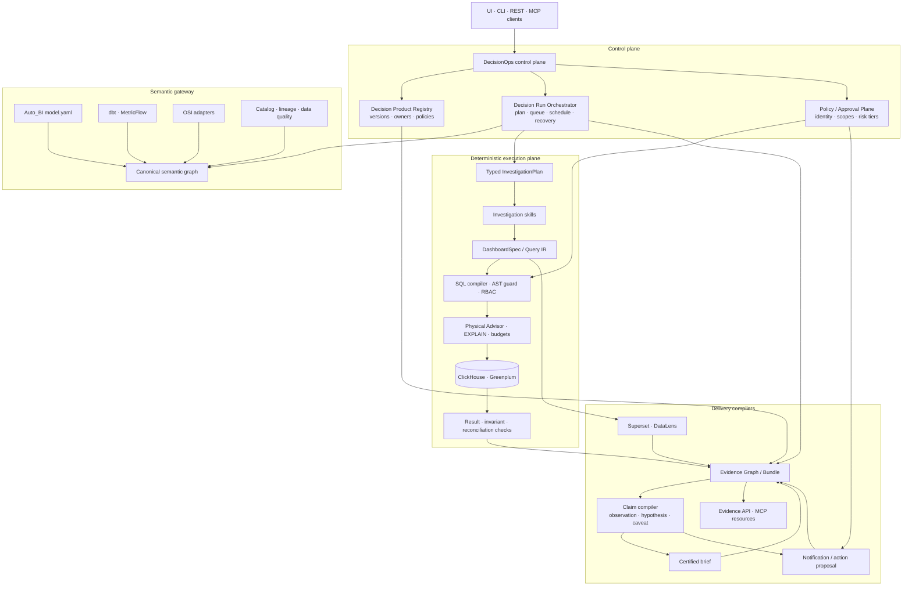

# Auto_BI 2026+: от генератора дашбордов к DecisionOps Control Plane

**Дата исследовательского среза:** 21 августа 2026  
**Горизонт плана:** 6 месяцев  
**Статус:** стратегическая концепция; не утверждённая спецификация реализации  
**Локальный baseline:** `D:\Auto_BI`, HEAD `b4bfa1d47db013b4529c8355da57c5e637a102d9`  
**Рабочее название следующего продукта:** **Auto_BI DecisionOps**

## Содержание

- [Резюме решения](#1-резюме-решения)
- [Что исследовано](#2-что-исследовано-и-где-границы-выводов)
- [Фактический baseline Auto_BI](#3-фактический-baseline-auto_bi)
- [Почему text-to-dashboard больше не moat](#4-почему-text-to-dashboard-больше-не-moat)
- [Стратегический выбор](#5-стратегический-выбор)
- [Концепция Auto_BI DecisionOps](#6-концепция-auto_bi-decisionops)
- [Продуктовые примитивы](#7-продуктовые-примитивы)
- [Целевые пользовательские сценарии](#8-целевые-пользовательские-сценарии)
- [Целевая архитектура](#9-целевая-архитектура)
- [Trust, security и governance](#10-trust-security-и-governance)
- [Метрики и evaluation](#11-метрики-и-evaluation)
- [Привязка к текущему коду](#12-привязка-к-текущему-коду)
- [План на 90 дней](#13-план-на-90-дней)
- [Roadmap на 6 месяцев](#14-roadmap-на-6-месяцев)
- [Первые 30 дней](#15-первые-30-дней-конкретный-план)
- [Go-to-market и упаковка](#16-go-to-market-и-упаковка)
- [Риски, kill criteria и решения](#17-риски-kill-criteria-и-решения)
- [Что сознательно не делать](#18-что-сознательно-не-делать)
- [Итоговая рекомендация](#19-итоговая-рекомендация)
- [Источники](#20-источники)

## 1. Резюме решения

Auto_BI банален не как инженерный проект. Наоборот, текущая версия заметно
сильнее типичного портфолио-прототипа: она имеет BI-независимый IR, строгую
семантическую валидацию, SQL guard, физический advisor для ClickHouse и
Greenplum, два BI-компилятора, durable recovery, auth/RBAC, eval и реальный
release-процесс. Банальной стала **исходная продуктовая категория** —
«опиши дашборд словами и получи визуализацию».

К августу 2026 эта функция быстро превращается во встроенную возможность BI- и
data-платформ:

- Power BI создаёт страницы отчёта через Copilot и хранит human-approved
  verified answers на уровне semantic model;
- DataLens строит новые чарты по датасету, поддерживает on-prem AI, Public API,
  MCP и внешних агентов; автоматический полный дашборд уже заявлен в планах;
- Looker, Databricks и Snowflake продуктово оформили data agents, verified
  queries/trusted assets, semantic governance и мониторинг качества;
- Tableau Next и ThoughtSpot двигаются дальше вопроса-ответа — к proactive
  alerts, многошаговому анализу и действиям в рабочих системах;
- dbt, Snowflake, Salesforce и другие участники развивают открытый формат
  семантики OSI, а MCP становится обычным интерфейсом между аналитикой и
  внешними агентами.

Следовательно, добавление Power BI-адаптера, ещё пяти визуализаций, нового LLM
или «более умного чата» увеличит demo surface, но не создаст защищаемой
категории. Рекомендуемый поворот:

> **Auto_BI DecisionOps — self-hosted vendor-neutral control plane, который
> превращает аналитическое намерение не просто в дашборд, а в версионируемый
> decision product: семантический контракт, проверенные запросы, дашборды,
> повторяемое исследование, evidence-rich briefing, мониторинг и безопасное
> предложение действия. Система непрерывно доказывает корректность семантики,
> доступов, данных, физической выполнимости и результатов во всех целевых BI.**

Единица продукта меняется:

| Было | Становится |
|---|---|
| `DashboardSpec` | `DecisionProductSpec`, внутри которого может быть один или несколько `DashboardSpec` |
| Разовая build-сессия | Версионируемый `DecisionRun` по запросу, расписанию или событию |
| Ссылка на дашборд | `EvidenceBundle`: ответ, данные, SQL, lineage, проверки, ограничения и артефакты |
| Advisor как предупреждение | Physical/cost gate и основание для управляемого изменения витрины |
| Golden replay промптов | Verified Query Repository + result-level regression + scenario eval |
| «Что видно» | Типизированные investigation skills с разделением факта, гипотезы и causal claim |
| BI как конечная точка | BI, briefing, API и MCP как компилируемые поверхности одного decision product |

Начинать нужно не со всей платформы. Первый клин на 90 дней:

> **Analytics Release & Evidence Gate** — команда и API, которые перед выпуском
> аналитического продукта проверяют semantic diff, числовую эквивалентность,
> freshness, access policy, физический план, BI-компиляцию и формируют
> воспроизводимый evidence artifact.

Этот клин использует именно то, что уже редко и хорошо сделано в Auto_BI:
IR-first, два компилятора, SQL guard, engine-aware advisor, contract tests и
durable audit trail. Затем поверх него строится Certified Decision Brief, а
только после доказанного спроса — расписания, MCP и approval-gated actions.

Главная продуктовая метрика:

> **Verified Decision Cycles (VDC) per active team per month** — число реально
> использованных циклов решения, для которых полный trust gate зелёный и
> сохранён evidence bundle.

Её обязательный quality guardrail:

> **Verified Decision Yield (VDY)** — доля адресуемых decision runs, которые
> завершились корректным, разрешённым, свежим, полным и воспроизводимым
> результатом без неподтверждённых утверждений.

## 2. Что исследовано и где границы выводов

### 2.1 Локальный аудит

Проверены актуальные документы, кодовые границы и состояние checkout:

- [README](../Auto_BI/README.md);
- [current state](../Auto_BI/docs/CURRENT_STATE.md) и
  [project closure](../Auto_BI/docs/PROJECT_CLOSURE.md);
- [архитектура](../Auto_BI/docs/ARCHITECTURE.md) и
  [исторический фазовый план](../Auto_BI/docs/PLAN.md);
- [рыночный срез от 11 июня](../Auto_BI/docs/MARKET.md);
- [операционная модель](../Auto_BI/docs/DEPLOYMENT.md);
- `DashboardSpec`, semantic model, deterministic insights, API surface,
  Store schema, адаптеры и структура тестов;
- текущий Git status и локальный HEAD.

Полный test suite в рамках этого исследования не запускался. Задача — выбрать
следующую продуктовую категорию и составить план, а не повторно аттестовать уже
закрытый v0.5.0. Поэтому тестовые числа ниже помечены как последние
зафиксированные проектом, а статические размеры измерены в текущем checkout.

### 2.2 Внешнее исследование

Проверены официальные документы и страницы Microsoft, Yandex Cloud, Google
Cloud/Looker, Databricks, Snowflake, Salesforce/Tableau, ThoughtSpot, Cube,
dbt, OSI, MCP, OpenLineage и NIST, а также первичные публикации Spider 2.0,
BIRD-INTERACT и DS-STAR. Источники перечислены в конце и даны рядом с
существенными тезисами.

### 2.3 Ограничения

- Не проведены интервью с потенциальными заказчиками. Поэтому ICP, jobs to be
  done и willingness-to-pay — гипотезы, а не подтверждённые факты.
- Конкуренты не прогонялись на одном и том же DWH и benchmark. Описания их
  возможностей взяты из официальных документов; маркетинговые заявления
  ThoughtSpot и Cube не считаются независимыми доказательствами качества.
- Сроки рассчитаны для одного сильного full-time разработчика с доступом к
  продуктовому владельцу и пилотному DWH. При работе вечерами реалистичный
  календарный горизонт — 9–12 месяцев.
- OSI и часть agentic-функций конкурентов ещё молоды или находятся в preview.
  План поэтому использует compatibility adapters, а не жёсткую зависимость от
  незрелого стандарта.
- Концепция не разрешает изменение текущих архитектурных инвариантов. Перед
  реализацией нового public IR нужен отдельный ADR и решение владельца.

## 3. Фактический baseline Auto_BI

### 3.1 Измеренный и зафиксированный baseline

| Показатель | Состояние на 2026-08-21 |
|---|---|
| Локальный HEAD | `b4bfa1d47db013b4529c8355da57c5e637a102d9` |
| Package/release | `autobi-agent` 0.5.0; software closure завершён |
| Production path | text / fields / auto → IR → SQL guard → ClickHouse → Superset |
| Experimental/secondary | Greenplum advisor/golden; DataLens compile и live contract 15/15 |
| Python source | 82 файла, 18 303 строки |
| Python tests | 98 файлов, 22 868 строк |
| Последний полный project gate | 1 376 passed, 4 skipped, 38 deselected; coverage 94,98% |
| Offline eval | 37 CH + 16 GP golden; 9 CH + 6 GP advisor cases |
| IR | 10 viz-типов, filters, joins, ratios, period comparisons, windows, histogram, layout |
| Semantic model | YAML: tables, grain, columns, roles, synonyms, joins, metrics, classification, physical metadata |
| Runtime state | SQLite schema v9, single process, `workers=1` |
| BI targets | Superset primary; self-hosted DataLens secondary |
| DWH engines | ClickHouse primary; Greenplum/Greengage secondary |
| LLM providers | Anthropic default; Mistral и GraceKelly options |
| Рабочее дерево | два ожидаемых untracked presentation artifacts; они не затрагивались |

### 3.2 Что уже сделано необычно хорошо

1. **IR-first как настоящая архитектурная граница.** LLM не пишет native BI
   payload; Pydantic IR валидируется, а Superset/DataLens конфигурации строит
   детерминированный код.
2. **Semantic grounding и запрет тихих исправлений.** Неизвестное поле, неверный
   join или бессмысленная агрегация отклоняются до BI mutation.
3. **Физический контекст DWH.** Semantic model хранит sorting/distribution/
   partition keys, статистику и cardinality; advisor объясняет стоимость и
   может сформировать `dm_change_request`.
4. **Безопасный execution seam.** SELECT-only AST guard, dialect parse,
   EXPLAIN, bounded trial, read-only роль и ограниченный raw SQL escape hatch.
5. **Два реальных компилятора.** Один spec проходит через Superset и DataLens,
   включая filters, layout, owned artifacts, cleanup и recovery.
6. **Редкая эксплуатационная дисциплина.** Durable build attempt, stable token,
   idempotency, exact ownership, startup reconciliation, backup/restore,
   release provenance и защищённые теги.
7. **Детерминированные insights.** Тренд, momentum, seasonality, anomaly,
   concentration и share считаются кодом, а не придумываются моделью.
8. **Хорошая основа eval.** Fingerprinted golden fixtures, replay, live
   sentinel, advisor cases и contract tests дают базу для следующего класса
   проверок.

Это не технический долг, который нужно выбросить. Это и есть ядро нового
продукта.

### 3.3 Где текущая модель заканчивается

| Разрыв | Что реально есть | Почему мешает следующему уровню |
|---|---|---|
| Единица ценности | Один build и ссылка на dashboard | Не фиксируется, какое решение поддерживается и было ли оно принято |
| Семантика | `Metric(name, sql, description)`; demo model фактически без named metrics | Нет time semantics, unit, owner, valid-from, dimensions, SLO, policy и compatibility contract |
| Quality loop | Golden replay и provider sentinel | Нет verified questions, result equivalence, production feedback queue и coverage map |
| Insights | Набор one-shot heuristics с demo-tuned thresholds | Нет typed investigation plan, hypothesis ledger и domain calibration |
| Proactivity | Нет scheduler/event triggers | Продукт ждёт запрос и не поддерживает регулярный decision cadence |
| Evidence | Trace events, SQL/LLM telemetry и artifacts существуют отдельно | Нет единого подписанного manifest «почему этому выводу можно доверять» |
| Lineage/impact | Model joins и SQL AST | Нет column-level lineage, semantic diff и downstream impact analysis |
| Governance | Schema-level RBAC, data classification, auth | Нет compile-time row/column policy, delegated identity и per-tool scopes |
| Actions | `dm_change_request` | Нет общего proposal/approval/postcondition contract для рабочих систем |
| Scale | SQLite, in-process limiter, один worker | Нельзя надёжно исполнять расписания и параллельные долгие runs в production |
| Distribution | UI/CLI/REST | Нет MCP surface для вызова другими корпоративными агентами |
| Outcome | Session/build status | Нет feedback, adoption, action outcome и business impact loop |

Эти пункты не являются дефектами v0.5.0: они соответствуют сознательно
закрытому scope. Но именно они отделяют dashboard generator от DecisionOps.

## 4. Почему text-to-dashboard больше не moat

### 4.1 Локальный рыночный документ уже устарел в главном тезисе

Срез [MARKET.md](../Auto_BI/docs/MARKET.md) от 11 июня корректно описывал
момент: встроенный DataLens Нейроаналитик создавал один чарт, а Auto_BI — целый
дашборд. На 24 июля картина изменилась:

- официальный DataLens материал говорит о Нейроаналитике 2.0, который строит
  новый чарт по датасету;
- внешние агенты уже могут работать с несколькими системами, готовить витрины
  и создавать/изменять объекты DataLens через Public API;
- официально перечислены Public API, skills, MCP server и Python SDK;
- on-prem Нейроаналитик поддерживается с релиза 26.5.1 при своей модели;
- полный дашборд встроенным Нейроаналитиком пока не собирается, но прямо указан
  как план развития.

Источник: [Yandex Cloud, «Как ИИ в DataLens ускоряет анализ данных и работу с
дашбордами», 24.07.2026](https://yandex.cloud/ru/blog/ai-datalens-data-analysis)
и [документация Нейроаналитика, обновлена 31.07.2026](https://yandex.cloud/ru/docs/datalens/dashboard/insights).

Следствие: отличие Auto_BI ещё существует как shipped implementation, но его
нельзя считать долговременным moat.

### 4.2 Верифицированные ответы становятся базовой функцией

Крупные платформы независимо пришли к одному паттерну: генеративному агенту
нужны эталонные пары «вопрос → проверенная логика».

- Power BI хранит human-approved visual answers и trigger phrases на уровне
  semantic model: [Verified answers](https://learn.microsoft.com/en-us/power-bi/create-reports/copilot-prepare-data-ai-verified-answers).
- Looker вводит verified queries как пары natural-language question и точного
  Explore query: [Explore data agents](https://docs.cloud.google.com/looker/docs/conversational-analytics-looker-data-agents).
- Databricks разделяет instructions, trusted assets и benchmarks; benchmark не
  подмешивается в context: [Genie Agents concepts](https://docs.databricks.com/aws/en/genie-agents/concepts).
- Snowflake имеет Verified Query Repository и suggestions из usage/query
  history: [VQR](https://docs.snowflake.com/en/user-guide/views-semantic/verified-query-repository)
  и [suggestions](https://docs.snowflake.com/en/user-guide/views-semantic/verified-query-suggestions).

Auto_BI имеет сильный offline replay, но ещё не продуктовую VQR, human review
queue, coverage по интентам и result-level acceptance.

### 4.3 Семантический слой становится инфраструктурой для AI

Snowflake хранит metrics, dimensions и relationships в queryable schema-level
Semantic Views; они используются Cortex Analyst и обычным SQL:
[официальный обзор](https://docs.snowflake.com/en/user-guide/views-semantic/overview).

dbt, Snowflake, Databricks, Salesforce и другие участники работают над Open
Semantic Interchange. OSI v0.1 задаёт vendor-neutral представление datasets,
metrics, dimensions, relationships и context:
[описание dbt](https://www.getdbt.com/blog/the-osi-spec-updates) и
[репозиторий OSI](https://github.com/open-semantic-interchange/OSI).

Cube уже позиционирует semantic layer как один источник для BI, embedded apps
и MCP-connected agents: [Cube documentation](https://docs.cube.dev/docs/introduction).
Это vendor claim, но направление рынка совпадает с независимыми шагами
Snowflake, dbt, Microsoft, Google и Databricks.

Следствие для Auto_BI: не надо строить ещё один закрытый semantic language.
Нужно стать **компилятором и контролем качества поверх нескольких semantic
sources**, сохранив внутреннюю каноническую модель.

### 4.4 Рынок уже идёт от ответа к исследованию и действию

- Databricks Agent mode дробит сложный вопрос на подзадачи, выполняет несколько
  SQL и возвращает структурированный отчёт с визуализациями:
  [Genie concepts](https://docs.databricks.com/aws/en/genie-agents/concepts).
- Looker preview agentic workflows мониторит изменения в данных, а data agents
  можно публиковать в другие приложения:
  [Looker data agents](https://docs.cloud.google.com/looker/docs/conversational-analytics-looker-data-agents).
- Tableau Next объединяет data analysis, semantic model curation и proactive
  alerts в Agentforce for Analytics:
  [Tableau Next setup](https://help.tableau.com/current/tableau-next/en-us/tableau_next_setup_guide_enable_tua_ai.htm).
- ThoughtSpot заявляет multi-step analysis и workflow actions в Jira,
  Salesforce и Slack: [Spotter](https://www.thoughtspot.com/product/agents/spotter).
- Cube добавил MCP connectors к Notion, Linear, Sentry и CRM:
  [MCP Connectors](https://cube.dev/blog/introducing-mcp-connectors).

Значит, «мы умеем задать вопрос данным» недостаточно. Ценность смещается к
тому, **можно ли доверять цепочке, повторять её, запускать проактивно и безопасно
встроить в рабочий процесс**.

### 4.5 MCP становится обязательной поверхностью, но не moat сам по себе

MCP 2026-07-28 стандартизирует stateless requests, tools/resources,
long-running Tasks, progress/cancellation и security principles:
[официальная спецификация](https://modelcontextprotocol.io/specification/2026-07-28).
Microsoft Fabric, DataLens, Looker и Cube уже документируют MCP surfaces.

Простой MCP server над raw SQL не создаёт ценности. Moat появляется, если
инструмент возвращает governed, permission-safe и проверяемый результат. Для
remote MCP нужны OAuth/OIDC discovery, audience-bound tokens, least privilege
и step-up authorization:
[MCP Authorization](https://modelcontextprotocol.io/specification/2026-07-28/basic/authorization).

### 4.6 Исследования запрещают выдавать multi-step autonomy за решённую задачу

- Spider 2.0 содержит 632 enterprise workflows с большими схемами и внешней
  документацией; агент на o1-preview в исходной работе решил лишь 17% задач:
  [paper](https://arxiv.org/abs/2411.07763).
- BIRD-INTERACT моделирует уточнения, knowledge retrieval и восстановление
  после ошибок в 600 интерактивных задачах:
  [paper](https://arxiv.org/abs/2510.05318).
- DS-STAR с итеративным planning и verification поднял DABStep только с 41,0%
  до 45,2%, что всё равно далеко от production trust:
  [Google Research](https://research.google/pubs/ds-star-data-science-agent-via-iterative-planning-and-verification/).

Вывод не в том, что agentic analysis бесполезен. Вывод в том, что Auto_BI не
должен обещать «автономного аналитика». Он должен продавать управляемую систему,
где вероятностный план окружён contracts, budgets, deterministic tools,
verification и human review.

### 4.7 Новый рыночный baseline

| Возможность | В августе 2026 | Значение для Auto_BI |
|---|---|---|
| NL→chart/report | Commodity внутри BI | Не делать центром позиционирования |
| Semantic grounding | Обязательная база | Импортировать/компилировать, не изобретать закрытый стандарт |
| Verified answers | Быстро становится нормой | Нужны VQR, review и result-level eval |
| Multi-step investigation | Появилось у лидеров | Нужен узкий typed skill catalog, не generic multi-agent |
| Proactive monitoring | Preview/production у лидеров | Добавлять после trust kernel и с alert precision gate |
| Workflow actions | Уже продаётся | Только proposal + approval + postcondition |
| MCP distribution | Обычный интерфейс | Делать после стабильного REST и policy plane |
| Cross-BI physical proof | Почти не является headline конкурентов | Главный шанс Auto_BI |
| Self-hosted heterogenous RU stack | Покрывается фрагментарно | Начальный ICP и дифференциация |

## 5. Стратегический выбор

### 5.1 Рассмотренные варианты

Оценка 1–5: чем выше, тем лучше. `Risk` инвертирован: 5 означает низкий риск.

| Вариант | Использует текущие активы | Дифференциация | Time-to-proof | Долговременность | Risk | Итог |
|---|---:|---:|---:|---:|---:|---:|
| A. Больше BI/DWH-адаптеров | 4 | 1 | 3 | 1 | 3 | 12 |
| B. Универсальный conversational analytics agent | 3 | 1 | 2 | 2 | 1 | 9 |
| C. Собственный universal semantic layer | 3 | 2 | 1 | 3 | 1 | 10 |
| D. Только cross-BI migration/QA tool | 5 | 4 | 5 | 3 | 4 | 21 |
| E. DecisionOps control plane; D как первый клин | 5 | 5 | 3 | 5 | 3 | **21** |

Вариант D столь же силён по сумме, но ограничивает потолок продукта. Поэтому
рекомендуется E с жёсткой последовательностью: сначала доказать release/evidence
gate как самостоятельную ценность, затем расширять жизненный цикл.

### 5.2 Позиционирование

Неудачное:

> «AI-агент, который по тексту строит дашборды в Superset и DataLens».

Рекомендуемое:

> **«Open/self-hosted control plane для проверяемых аналитических продуктов:
> одна семантика и один decision contract компилируются в DWH, BI, briefing и
> агентские интерфейсы, а Auto_BI доказывает, что результат корректен, разрешён,
> свеж, выполним и воспроизводим».**

Короткая версия:

> **Auto_BI не рисует ещё один дашборд. Auto_BI выпускает и сопровождает
> доказуемый decision product поверх уже выбранных DWH и BI.**

### 5.3 Начальный ICP

Первый идеальный профиль заказчика:

- средняя или крупная компания в РФ/СНГ;
- on-prem или hybrid data stack;
- ClickHouse и/или Greenplum/Greengage в DWH;
- Superset и/или DataLens как BI;
- 5–50 человек в data/analytics функции;
- повторяющиеся споры о формулах, регрессии после изменения витрин, дорогие
  дашборды, ручные еженедельные отчёты или миграция BI;
- невозможно или нежелательно отправлять данные в закрытый SaaS copilot;
- есть владелец 1–2 критичных decision workflows и готовность дать read-only
  доступ к пилотной витрине.

Покупатель: Head of Data, руководитель BI/DWH, CDO или владелец data platform.  
Пользователи: analytics engineer, BI analyst, владелец бизнес-метрики,
операционный менеджер.  
Не первый пользователь: массовый сотрудник, которому нужен «чат со всеми
данными компании».

### 5.4 Jobs to be done

1. «Перед выпуском изменения докажи, что критичные метрики и дашборды не
   сломались семантически, численно, по доступам и производительности».
2. «Каждую неделю дай мне один и тот же проверяемый briefing, объясни существенные
   изменения и покажи доказательства, а не правдоподобный narrative».
3. «Если KPI изменился, разложи вклад по согласованным измерениям и честно
   отдели наблюдение от гипотезы».
4. «При миграции Superset ↔ DataLens докажи равенство чисел и полноту поведения,
   а не только похожесть скриншотов».
5. «Если запрос требует другой витрины, сформируй evidence-backed change request
   и покажи downstream impact».
6. «Дай внешнему корпоративному агенту безопасный инструмент получить
   сертифицированный ответ, не открывая raw SQL и лишние данные».

## 6. Концепция Auto_BI DecisionOps

### 6.1 Три сущности вместо одной build-сессии

**Decision Product** — долговечный контракт аналитического продукта. Он знает:

- какое решение поддерживает;
- кто владелец и аудитория;
- какие метрики, определения, dimensions и временные правила допустимы;
- какие вопросы адресуемы, а какие требуют уточнения или эскалации;
- какие проверки, SLO и бюджеты обязательны;
- какие dashboard/brief/API/MCP surfaces публикуются;
- какое действие можно только предложить, а какое разрешено после approval.

**Decision Run** — один воспроизводимый запуск конкретной версии product spec
на конкретной версии semantic context и данных.

**Evidence Bundle** — неизменяемое доказательство результата запуска: input,
версии, lineage, запросы, планы, result hashes, проверки, caveats, output и
решение человека.

### 6.2 Принципы

1. **DashboardSpec сохраняется.** Он становится presentation IR внутри более
   высокого контракта, а не переписывается в первый месяц.
2. **Semantics before generation.** LLM выбирает из governed concepts; формулы,
   joins, access rules и physical gates исполняет код.
3. **Evidence before prose.** Narrative компилируется только из утверждений,
   у которых есть machine-readable evidence reference.
4. **Observation ≠ hypothesis ≠ causality.** Описательная корреляция не
   называется причиной. Causal claim разрешается только специальным skill с
   явно заданным дизайном эксперимента/квазиэксперимента.
5. **Open semantic interoperability.** Native Auto_BI model остаётся
   поддержанным, но canonical gateway импортирует dbt/MetricFlow и OSI.
6. **Cross-surface equivalence.** Число обязано совпадать между evidence,
   briefing и поддержанными BI surfaces в пределах объявленной tolerance.
7. **Human authority for mutation.** Первый год продукт может предлагать
   действия, но не изменяет бизнес-системы без явного approval.
8. **Local-first, production-capable.** SQLite остаётся developer mode;
   production runtime получает durable job store и horizontal workers только
   после доказанного recurring use case.
9. **Budget is part of correctness.** Scan fraction, latency, rows, LLM tokens и
   стоимость входят в policy, а не только в telemetry.
10. **Every claim has a lifecycle.** Версии метрик, decision products,
    verified questions и evidence можно воспроизвести, сравнить и вывести из
    эксплуатации.

### 6.3 Что продуктом не является

- Не новая BI-платформа и не замена Superset/DataLens.
- Не ещё один warehouse или caching engine.
- Не конкурент dbt/MetricFlow/Cube по всей ширине semantic layer.
- Не универсальный AutoML/data-science агент.
- Не generic workflow automation вроде n8n.
- Не система, самостоятельно принимающая высокорисковые бизнес-решения.
- Не обещание причинно-следственного анализа из обычной агрегации.

### 6.4 Trust levels вместо выдуманной вероятности

| Уровень | Условия | Что можно показать пользователю |
|---|---|---|
| `certified` | Verified asset matched; result/invariants/access/freshness/physical gates green | «Сертифицированный ответ», exact evidence |
| `governed` | Запрос скомпилирован из MetricContract; все runtime gates green; VQR не покрывает intent | «Проверено по контракту», с caveat об отсутствии эталона |
| `exploratory` | Новый investigation path, разрешённый и проверенный, но без полного semantic/result proof | «Исследовательский вывод», обязательный review |
| `insufficient` | Нет данных, stale source, неоднозначность, unsupported method или budget violation | Ответ не маскирует разрыв; уточнение/DCR/эскалация |
| `blocked` | Policy/access/security violation | Выполнение не происходит |

Нельзя показывать «confidence 92%», если это число не откалибровано на
репрезентативном наборе. Trust level определяется проверяемыми условиями.

## 7. Продуктовые примитивы

### 7.1 Metric Contract

Текущий `Metric(name, sql, description)` расширяется не правкой существующего
класса в первый день, а новым versioned contract над semantic gateway.

Минимальные поля:

- stable id, display name, owner, lifecycle status;
- formula или ссылка на external semantic definition;
- numerator/denominator для ratio;
- grain, allowed dimensions и join paths;
- additivity/semi-additivity и non-additive axes;
- event time, timezone, fiscal calendar, valid-from/valid-to;
- unit, currency, precision, null/zero policy;
- default filters и exclusions;
- freshness SLO и data-quality preconditions;
- classification, row/column/tenant policy reference;
- physical budget: max scan fraction/bytes/time;
- lineage references;
- verified questions и invariant tests;
- compatibility mapping для Auto_BI, dbt/MetricFlow и OSI.

Metric Contract не обязан хранить raw SQL. Предпочтительный порядок:

1. ссылка на внешнюю governed metric;
2. типизированная Auto_BI formula;
3. reviewed parameterized SQL как legacy/escape hatch.

### 7.2 DecisionProductSpec

Ниже — эскиз, а не утверждённый public schema:

```yaml
api_version: auto-bi/v2alpha1
kind: DecisionProduct
metadata:
  id: weekly_margin_review
  version: 7
  owner: commercial-analytics
  risk_tier: medium

decision:
  question: Почему валовая маржа изменилась на этой неделе?
  consumer: commercial-director
  cadence: weekly
  decision_deadline: Monday 09:00 Europe/Moscow
  intended_action: review_promo_and_inventory_plan

scope:
  metrics:
    - semantic://sales/gross_margin_pct@3
    - semantic://sales/revenue@5
  dimensions: [region, store_format, category, brand]
  time_window: P13W
  comparison: previous_period

investigation:
  skills:
    - data_health
    - trend_change
    - contribution_decomposition
    - concentration_shift
  max_queries: 18
  max_runtime_seconds: 90
  causal_claims: forbidden

verification:
  freshness_max_age: PT6H
  max_scan_fraction: 0.25
  require_verified_metric: true
  cross_surface_tolerance: 0.000001
  unsupported_claims_allowed: 0

delivery:
  dashboard:
    targets: [superset, datalens]
  briefing:
    formats: [html, markdown]
  notification:
    channel: webhook
    on: [material_change, failed_gate]

actions:
  mode: propose_only
  approval_role: commercial-director
  postcondition: ticket_created_and_linked
```

Главное поле — `decision`, а не `title`. Если команда не может назвать решение,
владельца и cadence, продукт, скорее всего, создаёт очередной vanity dashboard.

### 7.3 InvestigationPlan IR

LLM может предложить план, но исполнение принимает только typed plan:

- вопрос и scope;
- ordered steps;
- skill id и версия;
- входные metric/dimension refs;
- preconditions;
- ожидаемый evidence type;
- budget;
- stop conditions;
- ambiguity/escalation condition;
- разрешённый тип утверждения.

Первые deterministic skills:

1. `data_health`: freshness, completeness, duplicate/grain checks, null shifts;
2. `trend_change`: level/trend/change point с minimum support;
3. `period_variance`: current vs previous/YoY с calendar semantics;
4. `contribution_decomposition`: additive delta по разрешённым dimensions;
5. `mix_shift`: изменение структуры/долей;
6. `concentration_shift`: top-N/HHI или согласованный аналог;
7. `cohort_retention`: только при явном entity/event contract;
8. `funnel`: только при ordered-event semantics;
9. `physical_feasibility`: текущий advisor как обязательный step;
10. `data_gap`: формирует DCR, если ответ требует отсутствующей витрины.

Не начинать с Python code interpreter. Сначала 4–6 domain-neutral skills,
которые можно протестировать на fixtures и реальных агрегатах.

### 7.4 Verified Query Repository и Coverage Map

VQR хранит не просто golden SQL:

- canonical question и paraphrases;
- typed intent/MetricContract references;
- expected clarification или rejection;
- reference query/plan;
- expected result или invariants;
- allowed tolerances;
- valid semantic/model versions;
- reviewer, timestamp и rationale;
- risk tier;
- production feedback links.

Coverage Map показывает:

- какие intent families сертифицированы;
- какие только governed;
- где много production questions, но нет эталона;
- какие model/metric changes инвалидируют verified asset;
- где false clarification/false answer чаще всего.

Production interaction никогда автоматически не становится trusted asset. Она
попадает в review queue с redaction и дедупликацией.

### 7.5 Evidence Bundle и Evidence Graph

Один bundle должен содержать:

- decision product id/version и run id;
- actor/tenant/roles и policy decision ids;
- semantic source/version/hash;
- metric contract versions;
- DWH engine, catalog snapshot/freshness, source dataset versions;
- InvestigationPlan и фактически выполненные steps;
- canonical SQL hashes и безопасно сохранённые тексты по policy;
- EXPLAIN/scan/latency/row-count evidence;
- bounded/full-result markers;
- result schema, digest и ключевые aggregates;
- cross-target reconciliation;
- data-quality, security и budget gate results;
- каждый factual claim с `evidence_ref`;
- dashboard/brief/notification artifacts;
- LLM provider/model/prompt fingerprint/usage без чувствительных payloads;
- approvals, feedback, action proposal и postcondition;
- caveats и reasons for insufficient/blocked.

Для lineage не нужно придумывать свой общий стандарт. SQLGlot может дать
локальную derivation, dbt — project lineage, а обмен можно строить через
OpenLineage column facets:
[спецификация](https://openlineage.io/docs/spec/facets/dataset-facets/column_lineage_facet/).

Evidence Graph связывает:

```text
business question
  -> decision product version
  -> metric contracts
  -> semantic entities / source columns
  -> query plan / SQL / DWH execution
  -> result digest
  -> factual claims
  -> dashboard widgets / briefing paragraphs
  -> approval / action / outcome
```

### 7.6 Analytics Release & Evidence Gate

Это первый самостоятельный продуктовый клин.

Вход:

- base и candidate semantic/model version;
- набор decision products или dashboards;
- target DWH/BI environments;
- verification policy.

Проверки:

1. schema/semantic diff;
2. affected metrics, questions, charts и decision products;
3. contract validation и VQR invalidation;
4. SQL compile и AST/security checks;
5. reference vs candidate result reconciliation;
6. physical-plan regression;
7. BI adapter compile/contract;
8. cross-BI numeric equivalence;
9. artifact ownership/cleanup dry-run;
10. evidence manifest и machine-readable exit code.

Выход:

- `pass`, `pass_with_advisory`, `needs_review` или `block`;
- Markdown/HTML summary;
- JSON evidence bundle для CI;
- affected-owner list;
- proposed DCR/semantic change, но без автоматической мутации.

### 7.7 Decision Run и continuous monitoring

После доказательства one-shot gate добавляются:

- schedule/event trigger;
- immutable spec binding;
- idempotency key;
- durable queue/lease/heartbeat/cancel;
- retry policy по типу ошибки;
- comparison with last certified run;
- materiality threshold и deduplication;
- review/acknowledge lifecycle;
- retention и reproducibility;
- stale/late/missed-run SLO.

Не посылать alert на каждую статистическую флуктуацию. Notification появляется,
только если green data-health gate, достаточная support, materiality и
deduplication одновременно выполнены.

### 7.8 Action Proposal

Action layer начинается с proposal-only:

- connector и operation;
- typed payload preview;
- evidence refs;
- business owner и approver;
- risk tier;
- idempotency key;
- expiry;
- required scopes;
- approval record;
- postcondition query;
- compensating action или manual rollback note.

Первая action surface — создать Jira/YouTrack/DCR ticket или отправить
webhook/email. Изменение цены, кампании, заказа или production DWH не входит в
MVP.

## 8. Целевые пользовательские сценарии

### 8.1 Сценарий 1: certified weekly margin brief

1. Владелец один раз утверждает definition gross margin, dimensions, cadence,
   thresholds и dashboard layout.
2. В понедельник scheduler фиксирует версии spec/semantics и запускает
   `data_health`.
3. При green gate выполняются period variance и contribution decomposition.
4. Advisor проверяет scan fraction и план.
5. Система генерирует Superset/DataLens dashboard и briefing из тех же result
   objects.
6. Каждое утверждение содержит ссылку на evidence; «маржа снизилась из-за X»
   заменяется на честное «X дал крупнейший наблюдаемый вклад в изменение».
7. Если изменение material, создаётся action proposal «review promo plan».
8. Директор принимает/отклоняет proposal и позже фиксирует outcome.

### 8.2 Сценарий 2: semantic change release gate

Analytics engineer меняет формулу revenue или grain витрины:

1. CI вызывает `auto_bi decision diff --base ... --candidate ...`.
2. Impact graph находит affected VQR, decision products и widgets.
3. Оба набора запросов исполняются в isolated/read-only environment.
4. Числа сравниваются с объявленной tolerance; advisor ловит новый full scan.
5. Gate блокирует выпуск и показывает владельцу: какая метрика изменилась, на
   сколько, какие вопросы больше не сертифицированы и что требуется пересмотреть.

### 8.3 Сценарий 3: Superset → DataLens migration certification

1. Один DecisionProductSpec компилируется в оба targets.
2. Система сравнивает не пиксели, а canonical query/result contracts, filters,
   grain, null policy, sort/top-N и supported degradations.
3. Browser contract остаётся дополнительным layout/accessibility gate.
4. Выдаётся migration evidence pack: equivalent, intentionally degraded или
   unsupported с точной причиной.

Это очень сильный портфолио- и коммерческий demo, потому что использует оба уже
реальных адаптера Auto_BI.

### 8.4 Сценарий 4: ad hoc «почему упала выручка?»

1. Grounding определяет metric contract и спрашивает период/сравнение, если они
   не заданы.
2. LLM предлагает typed plan из разрешённых skills.
3. Код проверяет additivity, dimensions, budget и доступы.
4. Каждый step исполняется отдельно и может остановить план при data gap.
5. Выход — не произвольный essay, а ranked observations, competing hypotheses,
   rejected hypotheses и remaining uncertainty.
6. Пользователь может сохранить удачный run как draft decision product или
   отправить verified asset на review.

### 8.5 Сценарий 5: витрина не поддерживает решение

Текущий Feasibility Advisor уже даёт подходящую основу:

1. Investigation требует dimension/latency, которых mart не обеспечивает.
2. Система не маскирует это большим scan или guessed join.
3. DCR включает requested decision, missing semantic/physical capability,
   lineage/impact, evidence, expected usage cadence и acceptance tests.
4. После изменения mart тот же DCR становится release gate fixture.

## 9. Целевая архитектура



### 9.1 Архитектурные границы

**LLM разрешено:**

- сопоставить wording с governed concepts;
- предложить InvestigationPlan из catalogued skills;
- выбрать порядок безопасных follow-up questions;
- сформулировать текст только из approved claims;
- предложить action draft.

**LLM запрещено:**

- придумывать формулу метрики, join или permission;
- писать native BI payload;
- обходить typed skill preconditions;
- выставлять trust level;
- самостоятельно называть корреляцию причиной;
- выполнять write-action;
- скрывать stale/truncated/partial result.

### 9.2 Semantic Gateway

Canonical internal graph нужен, но он не должен стать новым публичным
стандартом. Его задача — нормализовать:

- текущий Auto_BI YAML;
- dbt manifest/catalog и MetricFlow definitions;
- OSI artifacts;
- DWH introspection и physical metadata;
- BI capabilities;
- ownership/classification/policy references.

Import обязан быть loss-aware: неизвестный concept не заполняется guess'ом, а
получает explicit gap. Export в OSI включается только для поддержанного subset
и сопровождается conformance tests.

### 9.3 Storage и execution evolution

Не нужно сразу мигрировать всё с SQLite.

**Local/developer mode:**

- текущий SQLite Store;
- synchronous one-shot verify/run;
- filesystem evidence bundles;
- один worker.

**Pilot production mode:**

- `Store`/`JobStore` protocol;
- PostgreSQL для metadata, runs, approvals и leases;
- object storage/filesystem abstraction для больших evidence/result artifacts;
- отдельные API и worker processes;
- outbox для notifications;
- advisory locks/idempotency;
- queue сначала на PostgreSQL `SKIP LOCKED`; Redis/Kafka только при измеренной
  необходимости.

Это уменьшает риск platform rewrite до product proof.

### 9.4 Observability

Существующие `trace_events` и `llm_calls` нужно сохранить, но перейти к
distributed trace одного Decision Run:

- span на plan/skill/query/BI delivery/notification;
- semantic attributes для decision product, run, metric, policy и trust level;
- token/cost/latency без raw sensitive content;
- trace context через MCP;
- audit trail отдельно от operational traces.

OpenTelemetry уже стандартизирует общие GenAI attributes для agent/tool/
conversation/usage, но предупреждает, что messages и tool arguments могут
содержать чувствительные данные:
[GenAI attributes](https://opentelemetry.io/docs/specs/semconv/registry/attributes/gen-ai/).

### 9.5 API и CLI v2

Предлагаемый REST surface после стабилизации моделей:

```text
POST   /api/v2/decision-products
GET    /api/v2/decision-products/{id}
POST   /api/v2/decision-products/{id}:validate
POST   /api/v2/decision-products/{id}:diff
POST   /api/v2/decision-products/{id}/runs
GET    /api/v2/decision-runs/{run_id}
POST   /api/v2/decision-runs/{run_id}:approve
POST   /api/v2/decision-runs/{run_id}:cancel
GET    /api/v2/decision-runs/{run_id}/evidence
POST   /api/v2/decision-runs/{run_id}/feedback
GET    /api/v2/verification/coverage
```

CLI:

```text
auto_bi decision validate product.yaml
auto_bi decision verify product.yaml --evidence out/
auto_bi decision diff --base main --candidate HEAD
auto_bi decision run weekly_margin_review
auto_bi decision replay <run-id>
auto_bi decision evidence <run-id>
auto_bi serve-mcp
```

### 9.6 MCP surface

MCP появляется только после стабильного REST/policy contract. Первая версия
read-only:

- `list_decision_products`;
- `describe_metric`;
- `run_verified_analysis`;
- `get_decision_run`;
- `get_evidence_bundle`;
- `explain_trust_level`.

Отдельные scopes:

```text
decision:read
metric:read
analysis:run
evidence:read
action:propose
action:approve   # не выдаётся обычному agent client
```

Raw SQL tool и generic `execute_action` в public MCP v1 отсутствуют.

## 10. Trust, security и governance

### 10.1 Runtime-инварианты

1. Любой data access привязан к actor/tenant/role и audit event.
2. Row/column/tenant policy компилируется в query plan или enforced DWH role;
   prompt policy не считается security boundary.
3. Decision run фиксирует semantic/model/data versions до исполнения.
4. Любой result знает, полный он или bounded/truncated.
5. Factual claim без evidence reference не попадает в certified output.
6. Sensitive result payload не пишется в trace по умолчанию.
7. Remote mutation невозможна без typed action, approval, scope и idempotency.
8. Retry никогда не создаёт второе действие или второй BI artifact.
9. Cross-tenant cache запрещён; cache key включает policy context.
10. Отозванная/устаревшая metric version инвалидирует зависимые certified
    assets и требует re-verification.

### 10.2 Human oversight

NIST AI RMF рассматривает governance как непрерывную функцию, требует ясных
ролей, ongoing monitoring, feedback и документированной human-AI oversight:
[AI RMF Core](https://airc.nist.gov/airmf-resources/airmf/5-sec-core/).

Для Auto_BI это означает не общий compliance badge, а конкретные сущности:

- owner у metric и decision product;
- reviewer у verified asset;
- approver у action;
- risk tier и review SLA;
- appeal/correction workflow;
- safe retirement старых agents/specs;
- incident link в evidence bundle.

### 10.3 Causal honesty

В UI и API должны быть разные типы claim:

| Тип | Допустимая формулировка | Требование |
|---|---|---|
| Observation | «Выручка снизилась на 8%» | Проверенный aggregate и comparison semantics |
| Contribution | «Категория X дала 42% наблюдаемого снижения» | Additive decomposition и reconciliation |
| Association | «Снижение сильнее в сегменте X» | Support, uncertainty и multiple-comparison policy |
| Hypothesis | «Возможная причина — промо mix» | Evidence for/against и explicit uncertainty |
| Causal | «Изменение X вызвало Y» | Approved causal method/design, assumptions и reviewer |

До появления causal module последний тип запрещён.

### 10.4 Data minimization

Текущая default-deny политика samples — сильная база. Для DecisionOps добавить:

- per-skill declared data need;
- aggregation-first output;
- k-anonymity/min-group threshold для сегментов при необходимости;
- redaction of example values;
- evidence payload retention policy;
- separate storage of hashes vs raw result;
- consent/approval для внешнего LLM и connector.

## 11. Метрики и evaluation

### 11.1 North Star и guardrails

**North Star:** `Verified Decision Cycles per active team per month`.

Decision cycle считается только если:

1. run адресуем текущими contracts;
2. semantic, data, access, physical и result gates green;
3. output доставлен и открыт/использован;
4. evidence bundle complete;
5. владелец подтвердил useful/accepted или совершил связанное решение.

**Quality guardrail:**

```text
VDY = verified successful decision runs / all addressable decision runs
```

`insufficient` не является ошибкой качества, если система правильно отказалась;
но он снижает coverage и требует отдельной метрики.

### 11.2 Обязательный scorecard

| Измерение | Метрика | MVP gate |
|---|---|---:|
| Semantic correctness | Exact/result-equivalent answers на VQR | ≥95% на addressable pilot set |
| Cross-surface consistency | Dashboard/brief/API reconciliation | 100% для supported metrics |
| Unsupported claims | Claims без evidence или с неверным evidence | 0 |
| Access safety | Cross-role/tenant leakage scenarios | 0 |
| Clarification | Precision ненулевых уточнений | ≥90% |
| Refusal | Correct insufficient/blocked classification | ≥95% на designed negative set |
| Release gate | Known breaking changes caught | 100% critical seeded changes |
| False blocks | Safe changes ошибочно blocked | <5% |
| Investigation | Analyst acceptance без переписывания | ≥80% на выбранном workflow |
| Alert quality | Precision material notifications | ≥80%; <1 false alert/product/week |
| Reliability | Durable run success, без duplicate side effects | ≥99% в pilot window |
| Latency | p95 certified brief | ≤120 s для agreed pilot scope |
| Cost | DWH bytes/time + LLM cost per accepted run | Baseline и budget, без скрытого overrun |
| Adoption | Weekly active decision owners | ≥3 в pilot |
| Outcome | Accepted actions с recorded result | Измерять; не ставить target до pilot baseline |

Числа — стартовые product gates, не уже достигнутые показатели. После первых
30 реальных runs их нужно откалибровать.

### 11.3 Evaluation pyramid

**Layer 1 — contracts и deterministic units**

- schema validation;
- metric formula/grain/additivity/time semantics;
- policy compilation;
- claim-evidence referential integrity;
- evidence manifest canonicalization.

**Layer 2 — query/result equivalence**

- CH vs GP dialect cases;
- base vs candidate semantic version;
- Superset vs DataLens canonical result;
- metamorphic invariants: filter monotonicity, partition decomposition,
  share sum, ratio numerator/denominator, time-bucket conservation;
- property tests на permission boundaries.

**Layer 3 — VQR**

- canonical questions + 3–5 paraphrases;
- ambiguous, infeasible и out-of-scope variants;
- expected clarification;
- result accuracy, не только SQL string;
- contamination-safe holdout.

**Layer 4 — decision scenarios**

- data freshness failure;
- schema drift;
- metric version change;
- BI capability degradation;
- expensive plan;
- missing dimension/DCR;
- process death, retry, duplicate notification;
- policy revocation mid-run.

**Layer 5 — human and outcome evaluation**

- analyst correctness review;
- decision owner usefulness;
- time-to-verified-decision;
- repeated use;
- action acceptance/rejection reason;
- business outcome where attribution допустима.

### 11.4 Confidence calibration

Не объединять все проверки в одну «AI confidence score». UI показывает
раздельно:

- semantic status;
- data freshness/quality;
- result verification;
- physical feasibility;
- coverage/trust level;
- remaining uncertainty;
- human review status.

Это объяснимее и предотвращает ложную точность.

## 12. Привязка к текущему коду

### 12.1 Что сохраняется почти без изменения

| Текущий модуль | Новая роль |
|---|---|
| `auto_bi/ir/spec.py` | Presentation/query IR внутри DecisionProductSpec |
| `agent/sqlgen.py` | Deterministic query compiler для typed skills |
| `agent/sql_guard.py` | Обязательный execution security gate |
| `agent/query_plan.py` | Run-local evidence cache; позже persistent plan evidence refs |
| `agent/normalize.py` | Deterministic presentation normalization |
| `semantic/model.py` | Native semantic source adapter |
| `semantic/dbt_import.py` | Начало dbt gateway, но не полноценный MetricFlow importer |
| `advisor/*` | Physical feasibility/cost gate и DCR evidence |
| `adapters/*` | Delivery compilers и cross-BI verification targets |
| `agent/insights.py` | Источник первых deterministic skill primitives |
| `store/db.py` | Local mode и образец transactional patterns |
| `eval/*` | Основа VQR replay и scenario harness |
| `api/*` | v1 compatibility surface; v2 добавляется рядом |

### 12.2 Что добавляется

Предлагаемая структура, без требования создать все папки сразу:

```text
auto_bi/
  decision/
    spec.py              DecisionProductSpec / policies
    registry.py          versioning / lifecycle / ownership
    runs.py              durable DecisionRun state machine
  semantic/
    gateway.py           canonical graph and source protocols
    metric_contract.py
    osi.py               bounded import/export
    metricflow.py         adapter, not a second engine
    diff.py              semantic impact
  investigation/
    plan.py              typed InvestigationPlan
    registry.py          skill catalog and versions
    data_health.py
    variance.py
    contribution.py
    mix_shift.py
  evidence/
    model.py             EvidenceBundle schema
    claims.py            claim compiler + evidence refs
    lineage.py
    manifest.py
  verification/
    repository.py        VQR
    coverage.py
    reconcile.py
    release_gate.py
  jobs/
    store.py             JobStore protocol
    worker.py
    scheduler.py
    outbox.py
  actions/
    model.py             proposal / approval / postcondition
    webhook.py
    ticket.py
  mcp/
    server.py
    auth.py
```

### 12.3 Как не сломать инварианты v0.5.0

1. Не расширять `DashboardSpec` полями decision lifecycle.
2. Создать внешний `DecisionProductSpec`, который ссылается на существующий
   spec или генерирует его детерминированно.
3. Сначала поддержать existing `model.yaml` через `NativeSemanticSource`.
4. Ввести repository protocols до PostgreSQL migration.
5. Оставить текущие `/api/v1` и CLI совместимыми.
6. Любой новый LLM prompt — через существующий fingerprinted eval gate.
7. BI mutation остаётся за adapter build contract и durable attempt.
8. Action connector получает отдельный ownership/idempotency ledger, не
   переиспользует BI artifact ledger семантически.

### 12.4 Эволюция `insights.py`

Текущие функции полезны, но thresholds отмечены как настроенные на demo scale.
Путь развития:

1. вынести `Observation` в versioned evidence type;
2. превратить каждый алгоритм в skill с declared preconditions;
3. добавить support/sample-size и calibration metadata;
4. тестировать на synthetic generators и anonymized pilot series;
5. разделить generic defaults и domain profile;
6. сохранить deterministic RU formatting как delivery layer;
7. не добавлять LLM «для красоты» до claim compiler.

### 12.5 Связь с NL_SQL Proof

Если параллельно развивается концепция из [sql.md](sql.md), проекты не
должны дублировать друг друга:

- **NL_SQL Proof** — trust kernel для одного аналитического вопроса: IntentIR,
  Semantic Contract, governed SQL и Evidence Card;
- **Auto_BI DecisionOps** — lifecycle нескольких metrics/questions/surfaces:
  release gate, decision product, recurring run, dashboard/brief, cross-BI
  reconciliation, approval и outcome.

Возможная будущая интеграция — Auto_BI вызывает NL_SQL Proof через стабильный
contract. На первые 90 дней проекты должны оставаться независимо поставляемыми,
чтобы интеграция не стала блокером.

## 13. План на 90 дней

### 13.1 Цель 90-дневного вертикального релиза

Показать один реальный decision product, который:

1. импортирует governed metrics из current Auto_BI model и одного внешнего
   формата;
2. имеет 25–30 verified questions/variants;
3. проходит semantic/data/access/physical/result gates;
4. выпускается одновременно как dashboard и certified Markdown/HTML brief;
5. формирует полный evidence bundle;
6. блокирует seeded breaking change;
7. проходит review минимум у пяти пользователей пилотной роли.

### 13.2 Пакет 0 — Product cut и discovery, недели 1–2

**Работа**

- 12–15 интервью: BI lead, analytics engineer, decision owner;
- собрать 30 recurring reports/decisions и 10 последних incidents;
- оценить частоту, стоимость ручной проверки, последствия ошибки;
- выбрать один workflow и один pilot mart;
- зафиксировать non-goals и risk tier;
- описать «сегодня» и desired flow с измеряемым time-to-decision.

**Exit gate**

- минимум 5 интервью подтверждают одну и ту же повторяющуюся боль;
- минимум 2 команды готовы дать артефакты/данные для design partner pilot;
- у workflow есть named owner, weekly/monthly cadence и проверяемый outcome.

**Kill/redirect**

Если recurring decision pain не подтверждается, сузить продукт до Analytics
Release Gate и не строить scheduler/briefing.

### 13.3 Пакет 1 — Trust Kernel schema, недели 3–4

**Работа**

- ADR: DecisionProductSpec как additive outer IR;
- MetricContract v0;
- EvidenceBundle v0;
- trust levels и claim types;
- Native semantic adapter;
- canonical serialization/hash/versioning;
- 10 contract fixtures.

**Verification**

- round-trip без потерь;
- unknown fields fail-closed;
- deterministic hashes;
- backward-compatible current DashboardSpec;
- property tests на version invalidation.

### 13.4 Пакет 2 — VQR и result verification, недели 5–6

**Работа**

- VQR schema/repository;
- canonical question + paraphrases + expected clarification;
- result/invariant comparator;
- coverage report;
- review metadata;
- 25 pilot entries.

**Verification**

- benchmark не попадает в production prompt автоматически;
- semantically equivalent row order/float formats reconcile;
- materially different result fails;
- metric/model version invalidates affected assets;
- negative/ambiguous questions классифицируются корректно.

### 13.5 Пакет 3 — Analytics Release Gate, недели 7–8

**Работа**

- semantic diff/impact;
- base-vs-candidate compile and execute;
- physical-plan regression;
- cross-BI canonical result check;
- JSON/Markdown evidence output;
- CLI exit codes;
- 20 seeded change scenarios.

**Verification**

- все critical seeded breaks caught;
- safe presentation-only change не block;
- no duplicate BI artifacts в dry-run/verify;
- evidence bundle воспроизводим;
- `git diff`/CI summary показывает affected owners и exact reasons.

### 13.6 Пакет 4 — Typed investigation MVP, недели 9–10

**Работа**

- InvestigationPlan v0;
- четыре skills: data health, period variance, contribution, concentration;
- budget/stop policy;
- claim compiler;
- explicit hypothesis/caveat types;
- преобразование evidence в briefing blocks.

**Verification**

- synthetic truth sets;
- additive decomposition reconciles to total delta;
- unsupported dimension даёт data gap/DCR;
- no causal wording;
- zero evidence-less factual claims.

### 13.7 Пакет 5 — Certified Decision Brief, недели 11–12

**Работа**

- DecisionProductSpec связывает metrics, plan, DashboardSpec и brief;
- HTML/Markdown output;
- Superset + DataLens build из одних canonical results/specs;
- review/feedback endpoint;
- public/offline killer demo;
- pilot usability session.

**90-day release gate**

- ≥95% result correctness на addressable VQR;
- 100% cross-surface reconciliation для supported metrics;
- 0 permission leaks и unsupported claims;
- ≥80% analyst acceptance на 10 pilot briefs;
- 5/5 пользователей понимают trust level и могут открыть evidence;
- один intentionally broken semantic change блокируется с точным impact;
- весь demo запускается без внешнего SaaS BI/LLM в offline/fixture mode.

Если gate не выполнен, не добавлять scheduler, MCP или actions. Исправлять
trust/product loop.

## 14. Roadmap на 6 месяцев

### 14.1 Потоки

**Поток A — Trust & semantics**

- MetricContract, semantic gateway, OSI/dbt adapters;
- VQR, coverage, result equivalence;
- lineage, policy и evidence.

**Поток B — Decision product**

- InvestigationPlan/skills;
- certified brief/dashboard;
- schedules, materiality, feedback/outcome.

**Поток C — Platform**

- durable jobs/PostgreSQL;
- OIDC/RLS/CLS;
- MCP/connectors;
- deployment, SLO, operations.

Поток C не должен опережать подтверждённую потребность потока B.

### Фаза 0 — Discovery и product cut, недели 1–2

Результат: выбран один decision workflow и два design partners.  
Gate: повторяющаяся дорогая боль подтверждена.  
Не делать: UI redesign, новые adapters, scheduler.

### Фаза 1 — Trust Kernel, недели 3–6

Результат: MetricContract, EvidenceBundle, Native semantic source и VQR.  
Gate: 25 verified entries, deterministic evidence, permission/property tests.  
Не делать: multi-agent и внешние actions.

### Фаза 2 — Analytics Release Gate, недели 7–8

Результат: CLI/API/CI artifact для semantic/result/physical/cross-BI diff.  
Gate: 100% seeded critical regressions caught; <5% false blocks.  
Коммерческий checkpoint: можно ли продать gate отдельно как audit/pilot.

### Фаза 3 — Certified Decision Brief MVP, недели 9–12

Результат: один DecisionProductSpec → verified investigation → dashboard +
brief + evidence.  
Gate: 90-day criteria из §13.7.  
Версия: `v0.6.0` experimental, не обещать production autonomy.

### Фаза 4 — Continuous Decision Runs, недели 13–16

Результат:

- JobStore protocol и PostgreSQL pilot backend;
- worker leases, cancellation, retries, outbox;
- scheduler/event trigger;
- materiality/dedupe/acknowledgement;
- comparison с last certified run;
- missed/stale run monitoring.

Gate:

- 30 дней без lost/duplicate run;
- 99% durable execution success в pilot scope;
- recovery tests на process death;
- <1 false material alert/product/week;
- минимум 3 decision owners открывают recurring output еженедельно.

### Фаза 5 — MCP и approval-gated workflow, недели 17–20

Результат:

- read-only MCP server 2026-07-28;
- OAuth/OIDC discovery и per-tool scopes;
- Tasks/cancel для длинного run;
- webhook/email + Jira/YouTrack proposal connector;
- approval/postcondition ledger;
- agent-to-agent integration demo.

Gate:

- identity/policy parity между REST/UI/MCP;
- 0 raw SQL/data exposure outside granted scope;
- every action proposal human-approved;
- retry создаёт ровно один external artifact;
- distributed trace связывает client → MCP → run → query → evidence.

### Фаза 6 — Pilot hardening и productization, недели 21–24

Результат:

- OIDC/SSO, delegated identity;
- row/column policy adapters;
- backup/restore и retention для PostgreSQL/evidence store;
- HA/restart/load tests;
- tenant isolation;
- operator runbooks;
- adapter SDK/conformance kit;
- 2–3 design partner case studies.

Gate:

- 3 active pilot teams;
- ≥50 verified decision cycles;
- VDY ≥90% на production-addressable scope;
- zero high-severity access/evidence incidents;
- median time-to-verified-decision снижен минимум на 50% против ручного
  baseline;
- хотя бы один pilot готов продолжать использование/платить за поддержку.

Только после этого обсуждать `v1.0`, enterprise packaging и write actions
более высокого риска.

### 14.2 Критический путь

```text
customer evidence
  -> decision workflow cut
  -> MetricContract + EvidenceBundle
  -> VQR + result comparator
  -> release gate
  -> typed investigation
  -> certified brief
  -> recurring usage
  -> production jobs / MCP / actions
```

Нельзя переставлять последние три блока вперёд: технически эффектный MCP server
без verified product просто быстрее распространяет недоказанный ответ.

### 14.3 Ресурсная оценка

| Фаза | FTE-недели | Главная неопределённость |
|---|---:|---|
| Discovery | 2 | Доступ к реальным owners/incidents |
| Trust Kernel + VQR | 4 | Semantic normalization и result comparison |
| Release Gate | 2 | Cross-environment fixtures |
| Decision Brief MVP | 4 | Calibration investigation skills |
| Continuous runs | 4 | Durable job semantics и alert quality |
| MCP/workflow | 4 | Identity propagation и external idempotency |
| Hardening/pilot | 4 | RLS/CLS, deployment и real usage |
| **Итого** | **24 FTE-недели** | Без новых BI/DWH adapters |

Оценка не включает enterprise sales, юридическую работу, новый frontend и
поддержку нового DWH.

## 15. Первые 30 дней: конкретный план

### Неделя 1 — доказать проблему

- [ ] Сформулировать три interview scripts по ролям.
- [ ] Провести минимум 6 интервью.
- [ ] Собрать реальные examples: metric disputes, broken dashboards,
  migration checks, weekly reports.
- [ ] Измерить ручной lead time и стоимость ошибки.
- [ ] Выбрать один pilot decision и owner.

**Done when:** есть decision brief «as is», минимум три повторяющихся incidents и
письменное согласие owner проверить новый flow.

### Неделя 2 — зафиксировать product contract

- [ ] ADR: outer DecisionProductSpec, без изменения DashboardSpec.
- [ ] Threat/risk tier выбранного workflow.
- [ ] MetricContract v0 с time/additivity/unit/owner/freshness/policy.
- [ ] EvidenceBundle v0 и trust levels.
- [ ] 10 canonical/ambiguous/negative questions.

**Done when:** contracts проходят round-trip и владелец понимает каждый field,
не читая код.

### Неделя 3 — построить evidence path

- [ ] Native semantic source adapter.
- [ ] Один existing DashboardSpec привязан к DecisionProductSpec.
- [ ] Canonical query/result digest.
- [ ] Claim с обязательным evidence ref.
- [ ] CLI `decision validate` и `decision verify` prototype.
- [ ] JSON + Markdown evidence artifact.

**Done when:** offline fixture создаёт byte-stable evidence bundle; удаление
evidence ref ломает validation.

### Неделя 4 — первый release gate demo

- [ ] Base/candidate semantic diff.
- [ ] Seed: formula change, grain change, removed column, expensive plan,
  presentation-only change.
- [ ] Impact mapping до chart/question/owner.
- [ ] Result comparator.
- [ ] Superset/DataLens compile verification.
- [ ] 30-минутная demo session с decision owner и analytics engineer.

**Done when:** четыре breaking seeds блокируются с точной причиной, safe change
проходит, а пользователи считают artifact полезнее текущей ручной проверки.

### Решение на 30-й день

**Продолжать DecisionOps**, если:

- ≥5 из 12–15 интервью подтверждают recurring pain;
- ≥2 design partners готовы к пилоту;
- gate сокращает review time минимум на 30% на одном реальном change;
- пользователи доверяют evidence structure и понимают refusal/trust levels.

**Сузить до Release Gate**, если trust/release pain подтверждена, но recurring
decision brief не нужен.

**Остановить pivot**, если ни release incidents, ни recurring decision cost не
подтверждаются реальными артефактами.

## 16. Go-to-market и упаковка

### 16.1 Не продавать «AI dashboard builder»

Категорийное сообщение должно начинаться с риска и результата:

> «Выпускайте semantic/model/BI changes с доказательством, что критичные
> метрики, доступы, стоимость и dashboard outputs остались корректными».

Затем расширение:

> «Превратите прошедший gate аналитический продукт в повторяемый certified
> decision brief».

### 16.2 Три входных предложения

**1. Analytics Trust Audit — 1–2 недели**

- одна витрина;
- 5–10 критичных dashboards/questions;
- semantic/physical/access/cross-BI review;
- evidence pack и prioritized findings.

Цель — получить incidents/corpus и design partner, а не жить консалтингом.

**2. Release Gate Pilot — 4 недели**

- интеграция в один CI flow;
- 20 verified cases;
- base/candidate impact;
- numerical/physical/BI checks;
- measurable review-time reduction.

**3. Certified Decision Brief Pilot — 6–8 недель**

- один weekly/monthly decision product;
- dashboard + brief + evidence;
- feedback и adoption baseline;
- без автоматических write actions.

### 16.3 Public killer demo

Один reproducible retail scenario:

1. исходный weekly margin product проходит;
2. кандидат меняет formula/grain и проходит обычный SQL syntax check;
3. Auto_BI показывает semantic/result drift и affected questions;
4. другой candidate сохраняет числа, но создаёт 100% scan — advisor блокирует
   production policy;
5. исправленная версия компилируется в Superset и DataLens;
6. обе BI и briefing показывают одинаковые значения;
7. evidence bundle открывается из каждой claim;
8. весь demo имеет offline fixture mode и live optional mode.

Это сильнее очередного видео «введите текст — появился дашборд», потому что
демонстрирует проблему, которую нельзя решить одной красивой генерацией.

### 16.4 Упаковка

До customer evidence не менять MIT-лицензию и не проектировать сложный open-core.
Возможная будущая граница:

**Community:**

- local compiler;
- native semantic model;
- DashboardSpec/adapters;
- VQR schema;
- offline release gate;
- evidence bundle;
- Superset/ClickHouse path.

**Enterprise/support:**

- OIDC/SSO, delegated RLS/CLS;
- PostgreSQL workers/scheduler/HA;
- approvals/connectors;
- audit/retention/policy packs;
- enterprise BI/DWH adapters;
- support/SLA.

Но это гипотеза упаковки. Сначала нужно доказать, за какую конкретную операцию
клиент готов платить.

### 16.5 Единица коммерческой ценности

Не токены и не число сообщений. Возможные единицы после пилотов:

- monitored decision product;
- protected metric/domain;
- environment/release gate;
- enterprise support deployment.

Pricing нельзя фиксировать без интервью. Предпочтительно привязать его к
стоимости защищённого workflow, а не к непредсказуемому LLM consumption.

### 16.6 Moat

Защищаемым активом станет не prompt и не количество адаптеров, а комбинация:

1. semantic + physical + access + result evidence в одном compiler path;
2. cross-DWH/cross-BI equivalence fixtures;
3. corpus реальных metric changes, incidents и decision scenarios;
4. versioned VQR и calibrated investigation skills;
5. evidence/outcome history, которую можно безопасно replay;
6. on-prem/provider-neutral deployment;
7. trust conformance kit для новых adapters;
8. открытая совместимость с OSI/dbt/MCP без platform lock-in.

## 17. Риски, kill criteria и решения

### 17.1 Risk register

| Риск | Ранний сигнал | Митигация |
|---|---|---|
| Нет реальной боли | Интервью хвалят demo, но не дают incidents/owner | Kill broad pivot; оставить release gate/tooling |
| Scope explosion | Одновременно semantic layer, scheduler, frontend, MCP, actions | Жёсткий 90-day vertical; каждый новый layer после gate |
| Дублирование dbt/Cube | Команда моделирует свой query language и cache | Semantic gateway/adapters; canonical internal subset |
| OSI нестабилен | Breaking spec/converter changes | Bounded adapter, pin version, no public dependency |
| Hallucinated root cause | Narrative называет корреляцию причиной | Typed claims, causal forbidden, claim-evidence validator |
| Alert fatigue | Много unacknowledged/false alerts | Materiality, dedupe, precision gate, per-product budget |
| Низкая VQR coverage | Большинство вопросов exploratory | Coverage map, targeted review; honest insufficient |
| Permission leak | Семантика видна шире данных | Compile-time policy, delegated identity, adversarial tests |
| Evidence содержит секреты | Raw values/prompts в manifests/traces | Hashes, redaction, data minimization, separate secure payload store |
| PostgreSQL rewrite съедает квартал | Platform code раньше pilot usage | SQLite one-shot MVP; repository protocol first |
| BI API drift | Contract fails после target update | Version pins, conformance suite, capability snapshots |
| Actions создают ущерб | Wrong/duplicate external write | Proposal-only, approval, idempotency, postconditions |
| Vendor быстро копирует | BI добавляет full dashboard + monitoring | Фокус на heterogeneous/on-prem/cross-surface proof |
| Пилот не измеряет outcome | Есть opens, нет decision owner feedback | Outcome field и review cadence обязательны в pilot contract |

### 17.2 Kill criteria после 90 дней

Не переходить к continuous platform, если выполняется любое из условий:

- нет двух design partners;
- ни один реальный semantic/BI change не прошёл через release gate;
- result correctness <90% на addressable pilot set;
- есть хотя бы одна permission leakage или evidence-less certified claim;
- analyst acceptance <70%;
- brief не сокращает time-to-decision хотя бы на 30%;
- все пользователи хотят только одноразовую генерацию dashboard и не ценят
  proof/lifecycle.

В этом случае возможный здоровый результат — отдельный open-source Analytics
Release Gate, без попытки строить DecisionOps platform.

### 17.3 Go/no-go после 6 месяцев

**Go к v1.0**, если:

- 3 активных команды;
- ≥50 verified decision cycles;
- VDY ≥90% на согласованном addressable scope;
- ≥50% сокращение median time-to-verified-decision;
- recurring weekly/monthly use держится 8 недель;
- есть willingness-to-pay/support commitment;
- нет high-severity trust/security incidents.

**Оставить нишевым internal/tooling продуктом**, если release gate ценен, но
business users не используют briefs.

**Закрыть expansion**, если использование держится только на участии автора и
не переживает две недели без ручного сопровождения.

### 17.4 Решения, которые должен принять владелец перед реализацией

1. Первый ICP: regulated RU enterprise или более широкий global open-source.
2. Первый wedge: release gate, migration certification или weekly brief.
3. Доступность design partner и реального mart.
4. Допустим ли production PostgreSQL в шестимесячном scope.
5. Какой внешний semantic source первый: dbt/MetricFlow или OSI artifact.
6. Какие actions допустимы только как proposal.
7. Нужен ли отдельный repository/package или эволюция текущего Auto_BI.

Рекомендация по умолчанию: текущий repository, additive v2 modules, release gate
как wedge, dbt/MetricFlow import первым, OSI export experimental, actions
proposal-only.

## 18. Что сознательно не делать

В ближайшие 90 дней:

- не добавлять Power BI, Tableau, Metabase, Visiology или Luxms adapter;
- не строить новый dashboard editor;
- не добавлять новые chart types без требования pilot workflow;
- не проводить model bakeoff ради небольшого quality gain;
- не вводить generic multi-agent framework;
- не давать LLM свободно писать/исполнять Python;
- не строить свой vector knowledge base для schema descriptions;
- не переписывать SQLite на PostgreSQL до доказанного recurring use;
- не делать MCP раньше стабильного REST/policy/evidence contract;
- не выполнять write actions;
- не обещать causal root-cause analysis;
- не менять current DashboardSpec/BIAdapter invariants без ADR;
- не подменять product validation количеством тестов;
- не обновлять исторические closure документы Auto_BI как будто новая стратегия
  является незакрытым долгом v0.5.0.

После 90 дней новые возможности проходят один вопрос:

> Увеличивает ли это Verified Decision Cycles или Verified Decision Yield на
> выбранном workflow?

Если нет — это не приоритет.

## 19. Итоговая рекомендация

Auto_BI не нужно «спасать» технической модернизацией: у него уже есть сильное
ядро. Нужно поменять уровень абстракции и коммерческую единицу.

Самая разумная траектория:

1. **Сохранить v0.5.0 как закрытый dashboard compiler baseline.**
2. **За две недели подтвердить pain вокруг release trust и recurring
   decisions.**
3. **Построить additive trust kernel:** MetricContract, VQR, EvidenceBundle.
4. **Выпустить Analytics Release & Evidence Gate** как первый самостоятельный
   продукт.
5. **Доказать один Certified Decision Brief** поверх текущего IR/advisor/
   adapters.
6. **Только после повторяемого использования** добавить scheduler,
   PostgreSQL workers, MCP и proposal actions.

Сильнейшее отличие формулируется так:

> Вендорские agents помогают задавать вопросы внутри своей платформы. Auto_BI
> DecisionOps должен доказывать жизненный цикл аналитического решения между
> несколькими semantic sources, DWH, BI и агентами — локально, воспроизводимо и
> с учётом физики данных.

Если этот тезис подтверждается пилотами, проект выходит из commodity-категории
«text-to-dashboard» и становится инфраструктурой доверия для agentic analytics.
Если не подтверждается, узкий Analytics Release Gate всё равно остаётся
ценным, честным и хорошо совпадающим с уже написанным кодом продуктом.

## 20. Источники

### 20.1 Локальные

- [Auto_BI README](../Auto_BI/README.md)
- [Current state](../Auto_BI/docs/CURRENT_STATE.md)
- [Project closure](../Auto_BI/docs/PROJECT_CLOSURE.md)
- [Architecture](../Auto_BI/docs/ARCHITECTURE.md)
- [Phase history](../Auto_BI/docs/PLAN.md)
- [Market snapshot 2026-06-11](../Auto_BI/docs/MARKET.md)
- [Deployment](../Auto_BI/docs/DEPLOYMENT.md)
- [DashboardSpec](../Auto_BI/auto_bi/ir/spec.py)
- [Semantic model schema](../Auto_BI/auto_bi/semantic/model.py)
- [Deterministic insights](../Auto_BI/auto_bi/agent/insights.py)
- [Demo semantic model](../Auto_BI/semantic/model.yaml)

### 20.2 Официальные продуктовые источники

- Yandex Cloud — [ИИ в DataLens: анализ данных, чарты и внешние агенты,
  24.07.2026](https://yandex.cloud/ru/blog/ai-datalens-data-analysis)
- Yandex Cloud — [Нейроаналитик на дашборде, обновлено
  31.07.2026](https://yandex.cloud/ru/docs/datalens/dashboard/insights)
- Microsoft — [Copilot: verified answers](https://learn.microsoft.com/en-us/power-bi/create-reports/copilot-prepare-data-ai-verified-answers)
- Microsoft — [Copilot with Power BI reports and semantic
  models](https://learn.microsoft.com/en-us/power-bi/create-reports/copilot-reports-overview)
- Microsoft — [Fabric data agent SDK и MCP](https://learn.microsoft.com/en-us/fabric/data-science/fabric-data-agent-sdk)
- Google Cloud — [Looker Explore data agents](https://docs.cloud.google.com/looker/docs/conversational-analytics-looker-data-agents)
- Google Cloud — [Conversational Analytics API](https://cloud.google.com/blog/products/data-analytics/understanding-lookers-conversational-analytics-api)
- Databricks — [Genie Agents concepts](https://docs.databricks.com/aws/en/genie-agents/concepts)
- Databricks — [Tune Genie Agent quality](https://docs.databricks.com/aws/en/genie-agents/tune-quality)
- Databricks — [Test and monitor Genie Agent](https://docs.databricks.com/gcp/en/genie-agents/monitor)
- Snowflake — [Semantic Views overview](https://docs.snowflake.com/en/user-guide/views-semantic/overview)
- Snowflake — [Verified Query Repository](https://docs.snowflake.com/en/user-guide/views-semantic/verified-query-repository)
- Snowflake — [Semantic suggestions from usage/query
  history](https://docs.snowflake.com/en/user-guide/views-semantic/verified-query-suggestions)
- Tableau — [Agentforce for Analytics, semantic curation и proactive
  alerts](https://help.tableau.com/current/tableau-next/en-us/tableau_next_setup_guide_enable_tua_ai.htm)
- ThoughtSpot — [Spotter analytics agent](https://www.thoughtspot.com/product/agents/spotter)
- Cube — [Platform documentation](https://docs.cube.dev/docs/introduction)
- Cube — [MCP Connectors](https://cube.dev/blog/introducing-mcp-connectors)

### 20.3 Стандарты и open semantics

- Open Semantic Interchange — [OSI repository](https://github.com/open-semantic-interchange/OSI)
- dbt Labs — [What the OSI spec means for metrics, semantics and
  AI](https://www.getdbt.com/blog/the-osi-spec-updates)
- dbt Labs — [Open-source MetricFlow](https://www.getdbt.com/blog/open-source-metricflow-governed-metrics)
- Model Context Protocol — [Specification
  2026-07-28](https://modelcontextprotocol.io/specification/2026-07-28)
- Model Context Protocol — [Authorization
  2026-07-28](https://modelcontextprotocol.io/specification/2026-07-28/basic/authorization)
- OpenLineage — [Column-level lineage facet](https://openlineage.io/docs/spec/facets/dataset-facets/column_lineage_facet/)
- OpenTelemetry — [GenAI semantic attributes](https://opentelemetry.io/docs/specs/semconv/registry/attributes/gen-ai/)
- NIST — [AI RMF Core](https://airc.nist.gov/airmf-resources/airmf/5-sec-core/)

### 20.4 Исследования

- Lei et al. — [Spider 2.0: Evaluating Language Models on Real-World
  Enterprise Text-to-SQL Workflows](https://arxiv.org/abs/2411.07763), ICLR
  2025 Oral
- Huo et al. — [BIRD-INTERACT: Re-imagining Text-to-SQL Evaluation via
  Dynamic Interactions](https://arxiv.org/abs/2510.05318), ICLR 2026 Oral
- Google Research — [DS-STAR: Data Science Agent via Iterative Planning and
  Verification](https://research.google/pubs/ds-star-data-science-agent-via-iterative-planning-and-verification/)
