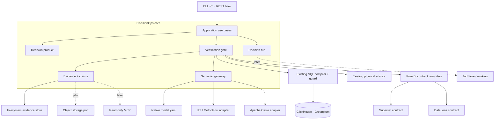
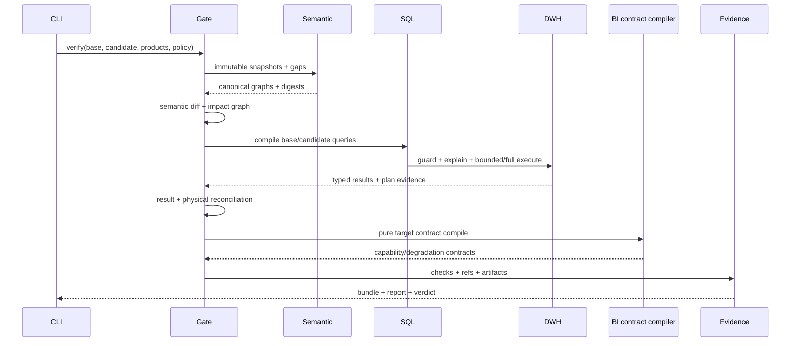

# Auto_BI DecisionOps — целевая архитектура

**Статус:** runtime клина release-gate реализован; платформенные модули после пилота не начаты
**Последнее обновление:** 2026-09-02
**Аудитория:** разработчики, analytics engineers, владельцы data platform
**Первый поставляемый продукт:** Analytics Release & Evidence Gate

Этот документ — нормативная архитектура нового проекта. Текущий дизайн
унаследованного dashboard compiler остаётся в [ARCHITECTURE.md](ARCHITECTURE.md),
а решение о форме нового проекта — в
[ADR 0003](adr/0003-decisionops-additive-control-plane.md). Стратегический
исследовательский вход сохранён как архивный срез в
[`DECISIONOPS_STRATEGY_2026-08-21.md`](history/DECISIONOPS_STRATEGY_2026-08-21.md).

## Содержание

- [Контекст и baseline](#1-контекст-и-измеренный-baseline)
- [Архитектурный результат](#2-архитектурный-результат)
- [Обязательные инварианты](#3-обязательные-инварианты)
- [Границы системы](#4-границы-системы)
- [Архитектурный стиль](#5-архитектурный-стиль-и-зависимости)
- [Карта модулей](#6-целевая-карта-модулей)
- [Доменные контракты](#7-доменные-контракты)
- [Release & Evidence Gate](#8-analytics-release--evidence-gate)
- [Evidence architecture](#9-evidence-architecture)
- [Security и governance](#10-security-и-governance)
- [Persistence](#11-persistence-и-execution-evolution)
- [Interfaces](#12-interfaces-и-совместимость)
- [Observability](#13-observability)
- [Привязка к текущему коду](#14-использование-текущего-кода)
- [Verification strategy](#15-verification-strategy)
- [Последовательность поставки](#16-последовательность-поставки)
- [Риски](#17-риски-и-решения)
- [Открытые решения](#18-открытые-продуктовые-решения)
- [Bootstrap acceptance](#19-bootstrap-acceptance)
- [Источники](#20-источники)

## 1. Контекст и измеренный baseline

Новый проект создан из tracked-состояния `D:\Auto_BI` на commit
`b4bfa1d47db013b4529c8355da57c5e637a102d9`. Исходный checkout имел два
untracked presentation artifact; они, `.env`, виртуальные окружения, кеши и
логи не переносились. Копия стратегии имеет SHA-256
`69823b008dd98e0df5dd7fb4d324b6608afc927b88dee430b4fb83568be11f4f`.

| Показатель | Текущий checkout | Следствие |
|---|---:|---|
| Tracked-файлы | 324 | Это зрелый fork, не greenfield rewrite |
| Python source | 82 файла / 20 824 физических строки | Новый слой должен быть additive |
| Python tests | 100 файлов / 27 960 физических строк | v1 regression suite остаётся обязательной |
| Package | `autobi-agent` 0.5.0 | Имя пакета пока не меняется |
| Runtime | Python 3.12+, FastAPI, Pydantic, sqlglot, SQLite | Нового framework в MVP не требуется |
| Primary path | ClickHouse + Superset | Первый live gate углубляет этот путь |
| Secondary path | Greenplum + DataLens | Используется для cross-target contracts |

Физические строки отличаются от чисел в стратегическом документе более чем на
10%, вероятно из-за другой метрики LOC. Для планирования используются текущие
файлы и реальные архитектурные швы, а не старые оценки размера.

## 2. Архитектурный результат

Auto_BI DecisionOps — modular monolith, который выпускает аналитический продукт
как проверяемый артефакт. Первый вертикальный путь принимает base/candidate
семантику, набор защищаемых вопросов и dashboard specs, выполняет детерминированные
проверки и возвращает verdict вместе с воспроизводимым evidence bundle.

```text
semantic/model change
        +
protected decision products / verified questions
        |
        v
Analytics Release & Evidence Gate
        |
        +--> semantic + impact diff
        +--> SQL/security/physical checks
        +--> result reconciliation
        +--> BI compile contracts
        |
        v
verdict + evidence bundle + owner impact report
```

Продукт не начинает с scheduler, PostgreSQL, MCP, нового UI, новых BI-адаптеров
или write-actions. Эти возможности не нужны, чтобы доказать первый customer
outcome: безопаснее и быстрее выпускать изменения семантики и BI.

## 3. Обязательные инварианты

1. `DashboardSpec` остаётся presentation/query IR и не получает поля lifecycle,
   approvals или evidence.
2. Существующий `BIAdapter` остаётся контрактом remote mutation; release gate не
   вызывает `BIAdapter.build()`.
3. Формулы, joins, policy decisions, trust level и gate verdict вычисляет код,
   а не LLM.
4. Каждый run до исполнения фиксирует точные версии product spec, semantic
   snapshots, policy и среды.
5. Factual claim без валидного `evidence_ref` не попадает в governed или
   certified output.
6. Неизвестная или непереносимая семантика становится явным gap; adapters не
   восстанавливают её догадкой.
7. Любой SQL проходит существующие SELECT-only, dialect, RBAC, `EXPLAIN` и
   bounded/full-result controls.
8. `operational_status` и `gate_verdict` — разные поля: технически успешный run
   может завершиться verdict `block`.
9. Evidence content-addressed и канонизирован; одинаковый вход обязан давать
   одинаковые contract hashes.
10. Raw sensitive payload, prompt/message content и result rows не входят в
    telemetry или public evidence по умолчанию.
11. Interoperability реализуется version-pinned adapters; внешний semantic
    standard не становится внутренним public IR.
12. Observation, contribution, association, hypothesis и causal claim — разные
    типы. Causal claim запрещён до отдельного проверенного модуля.

## 4. Границы системы



### 4.1 Trust boundaries

| Граница | Вход считается недоверенным | Обязательный контроль |
|---|---|---|
| CLI/API → application | YAML/JSON, paths, actor context | strict schema, path confinement, authz |
| CLI → offline investigation | `InvestigationPlan`, canonical result files, output path | exact metric coverage, strict budgets, `max_queries=0`, new output directory |
| Semantic source → gateway | внешние manifests/specs | version pin, loss report, fail-closed validation |
| Core → DWH | скомпилированный SQL | SELECT-only guard, DWH role, policy context, budgets |
| Core → BI | target payload | pure contract compile; remote build только вне release gate |
| Core → evidence store | результаты и metadata | classification, redaction, content digest, retention |
| LLM → core | plan/text candidates | typed catalog, preconditions, evidence refs, no authority |

## 5. Архитектурный стиль и зависимости

На первые 90 дней система остаётся одним Python package и одним CLI process.
Границы задаются протоколами и направлением импортов, а не сетевыми сервисами.

```text
interfaces (CLI / REST later)
            |
            v
application use cases
            |
            v
decision · verification · investigation
      |          |             |
      +----------+-------------+
                 v
       semantic · evidence
                 |
                 v
ports: SemanticSource · QueryExecutor · ArtifactStore · Clock · Signer
                 |
                 v
existing Auto_BI + filesystem/SQLite adapters
```

Правила зависимостей:

- domain-модели не импортируют FastAPI, CLI, SQLite, HTTP clients или конкретную BI;
- `verification` оркестрирует ports, но не знает provider payloads;
- `semantic` не импортирует `decision`; обратная ссылка задаётся стабильными refs;
- `evidence` знает типизированные результаты проверок, но не выполняет запросы;
- существующие `agent`, `advisor`, `ir` и `adapters` используются через тонкие
  application adapters;
- новые директории создаются только вместе с первым исполняемым контрактом, а
  не как набор пустых placeholders.

## 6. Целевая карта модулей

```text
auto_bi/
  strict.py              StrictModel(extra="forbid") — унаследованный shared kernel
  refs.py                stable ids и version-pinned refs
  scalars.py             decimal / duration / UTC timestamp / sha256 скаляры
  decision/
    spec.py              DecisionProductSpec и lifecycle enums
    validate.py          cross-contract validation
    impact.py            product/owner/chart impact и эскалация review→block
    use_cases.py         validate / verify application services
  semantic/
    metric_contract.py   governed metric definition
    gateway.py           source protocols, snapshot, gaps
    diff.py              semantic and impact diff
    metricflow.py        bounded dbt/MetricFlow import
    ossie.py             pinned Apache Ossie compatibility adapter
  verification/
    model.py             CheckResult, verdict and policy
    repository.py        VQR contracts и reviewed reference query
    reconcile.py         canonical result comparator
    provenance.py        откуда пришло кандидатное число: attestation и её проверка
    release_gate.py      orchestration only
    bi_contract.py       pure target compile contracts
  evidence/
    model.py             bundle/claim/artifact schemas
    canonical.py         JCS bytes and digests
    manifest.py          bundle assembly and referential integrity
    store.py             ArtifactStore protocol + filesystem adapter
    lineage.py           internal edges + OpenLineage projection
  investigation/
    model.py             strict InvestigationPlan, scope, budgets and policy
    data.py              CanonicalMetricResult supplied by a trusted read-only step
    skills.py            four deterministic v1 skills; observations or typed gaps
    claims.py            evidence-backed claims and deterministic Markdown blocks
    application.py       offline orchestration and local plan/results/brief artifacts
  jobs/                  starts only after recurring use is proven
  actions/               proposal-only, post-MVP
  mcp/                   read-only, post-REST contract
```

Карта сочетает реализованные seams и явно отложенные модули. Пять functional modules
offline investigation alpha получают готовые canonical results,
не получает `QueryExecutor`, DWH/BI adapter, LLM или сетевой transport и пишет новый
локальный каталог. `jobs`, `actions` и `mcp` остаются gated placeholders архитектуры,
а не обещанием текущей реализации.

`refs.py` и `scalars.py` лежат рядом с существующим `strict.py` как shared kernel:
это грамматика идентичности и скаляров из §7.1, у них нет доменного состояния и они
не создают направления зависимости между `decision`, `semantic` и `evidence`. По той
же причине `evidence/canonical.py` не тянет ничего, кроме stdlib: contract-модели
импортируют его ради digest, а не ради evidence-домена.

## 7. Доменные контракты

### 7.1 Общие правила идентичности и версий

- Stable ids — lowercase URI-like строки, например
  `metric://sales/gross_margin_pct` и `decision://sales/weekly_margin`.
- `version` — монотонная доменная версия; Git SHA или provider version хранится
  отдельно как source revision.
- Любой immutable snapshot имеет `sha256:<hex>` digest канонических bytes.
- В canonical contract запрещены `NaN`, infinities и platform-dependent values.
- Денежные, ratio и tolerance values сериализуются decimal-строками, а не
  бинарными float.
- Время хранится в UTC RFC 3339; business timezone/calendar остаются явными
  полями metric contract.
- Unknown keys отклоняются существующей моделью `StrictModel(extra="forbid")`.

### 7.2 DecisionProductSpec

`DecisionProductSpec` — внешний контракт над одним или несколькими
`DashboardSpec`. Эскиз `v2alpha1`:

```yaml
api_version: auto-bi.io/v2alpha1
kind: DecisionProduct
metadata:
  id: decision://sales/weekly_margin
  version: 1
  owner: commercial-analytics
  risk_tier: medium
decision:
  question: Почему изменилась валовая маржа?
  consumer: commercial-director
  cadence: weekly
scope:
  metrics: [metric://sales/gross_margin_pct@3]
  dimensions: [region, category]
  time_window: P13W
verification:
  policy: policy://release/default@1
  freshness_max_age: PT6H
  cross_surface_tolerance: "0.000001"
delivery:
  dashboards:
    - ref: dashboard://weekly_margin@7
  brief_formats: [markdown]
actions:
  mode: disabled
```

В alpha-схеме `decision`, `owner`, `metric refs` и verification policy
обязательны. Cadence описывает продукт, но scheduler не входит в MVP.

### 7.3 MetricContract

Минимальная переносимая часть:

- id, version, owner, lifecycle status;
- formula ref или typed numerator/denominator;
- grain, allowed dimensions и join paths;
- additivity и non-additive axes;
- event time, timezone и calendar;
- unit, precision, null/zero semantics;
- freshness и data-quality preconditions;
- classification/policy refs;
- physical budgets;
- lineage refs и verified asset refs.

Порядок разрешения формулы: external governed reference → typed Auto_BI
expression → reviewed parameterized SQL. Raw SQL не становится дефолтом.

### 7.4 SemanticSnapshot и SemanticGap

`SemanticSource.snapshot(ref) -> SemanticSnapshot` возвращает:

- source kind/version/revision;
- canonical graph поддержанного subset;
- source digest и canonical digest;
- declared capabilities;
- список `SemanticGap(path, reason, severity, source_value_ref)`;
- physical/catalog/policy refs без секретов.

Native `model.yaml` — первый source adapter. Текущий `dbt_import.py` остаётся
enrichment helper и не объявляется полноценным MetricFlow importer. Apache
Ossie (бывший OSI) используется через adapter, pinned на tag или commit;
неизвестные `custom_extensions` сохраняются для round-trip, но не получают
выдуманную внутреннюю семантику.

### 7.5 Verified Asset Repository

Verified asset содержит:

- canonical question и paraphrases;
- intent и metric refs;
- ожидаемое уточнение/refusal для negative cases;
- reference query plan **и — для позитивного asset'а — сам reviewed `reference_query`**;
- expected canonical result или invariants;
- tolerance, действующие semantic versions и risk tier;
- reviewer, rationale и review timestamp.

`reference_query` — это `{engine, sql}`, и он существует ради одной вещи: гейт не
исполняет запрос asset'а (§8.2 шаг 8 берёт числа из порта), поэтому digest reviewed-запроса
— единственное, с чем можно сравнить attestation кандидатного числа (§8.4). Адрес считается
по RFC 8785 от `{"engine": …, "sql": …}` — не только от текста: одна и та же строка на двух
движках значит разное, а внешний capture-runner обязан уметь получить тот же digest из тех
же двух строк. SQL проходит SELECT-only guard **на границе контракта**, при загрузке asset'а:
verified asset с `INSERT` — сломанный reviewed-артефакт, и инвариант 7 не становится
необязательным оттого, что этот SQL ещё никто не выполнял. Движок обязан быть известен
(`is_known_engine`): `sqlglot_dialect` подставляет v1-движок незнакомому имени, и охрана
PostgreSQL-текста ClickHouse-грамматикой либо отвергла бы валидный SQL, либо — хуже —
пропустила бы как SELECT то, что не разобрала.

Reviewed-запрос — якорь provenance-цепочки (§8.4.1), и стоит он ровно столько, сколько
стоит его привязка к governed-модели: запрос по `dm.sales_daily_v2` даёт attested число,
которое сходится с ожидаемым и посчитано по витрине, которой никто не управляет. Поэтому
`assets.invalidated` (шаг 5) сверяет reviewed-запрос с кандидатным snapshot'ом на двух
уровнях:

| Что читает запрос | Чего нет в snapshot'е | Код |
|---|---|---|
| таблица | витрина не объявлена | `asset.query_ungoverned` (review) |
| колонка governed-витрины | поле не объявлено | `asset.query_ungoverned_field` (review) |
| — | часть колонок не разрешается | `asset.query_fields_unchecked` (advisory) |

Оба уровня нужны: governance на уровне витрины говорит, что число «про эти витрины», а
метрика определена над **полями**, и запрос по governed-витрине, читающий необъявленную
колонку, считает число частично из данных, о которых модель ничего не говорит. Колонка
приписывается таблице **только там, где выбора не оставляет ни SQL, ни модель**:
квалифицированная — разрешается наружу по цепочке scope'ов, как её разрешает язык;
неквалифицированная — когда у её scope ровно один источник, а если источников несколько,
то когда ровно один из них объявляет это имя. Второй шаг — не догадка: движок этот SQL
принял, значит имя разрешилось ровно в один источник scope'а, и если модель оставляет
единственного кандидата, прочитать его — значит прочитать запрос. Вывод требует, чтобы
scope был виден целиком: неуправляемая витрина, CTE или подзапрос рядом держат колонки,
о которых snapshot не знает, и тогда имя не трогают. Если имя объявляют два governed-
источника — два источника, пусть даже это одна таблица, приджойненная к себе, — выбор
остаётся тем же, что был бы у движка, и приписать `category` одной из двух таблиц join'а
значило бы догадываться, а гейт, догадывающийся о governance, перестаёт быть evidence
(инвариант 6). Поэтому неразрешимое **называется**, а не пропускается:
`asset.query_fields_unchecked` (advisory) разбирает остаток по причинам — имя, объявленное
несколькими источниками; имя, чей scope модель не видит насквозь; квалификатор, которого
не объявляет ни один охватывающий scope; scope без собственных источников — и отдельно
сообщает про `SELECT *`, у которого состав колонок зависит от физической таблицы, а не от
текста запроса — частичная проверка не должна читаться как чистая. Остаток считается **по
ссылкам, а не по именам**: одно `category`, которое модель разрешила, ничего не говорит о
`z.category` в двух словах от него. Голое имя, которого не
объявляет ни один governed-источник его scope'а, попадает в `asset.query_ungoverned_field`
вместе с перечнем этих источников. Колонка неуправляемой витрины отдельной находкой не
становится: витрину и надо чинить, а один факт, оценённый дважды, весит вдвое.

Регистр читается по движку asset'а: ClickHouse различает `Sales_Daily` и `sales_daily`,
PostgreSQL-семейство складывает к нижнему регистру **неквотированный** идентификатор, — а
квотированное имя сравнивается точно на любом движке, потому что `"Sales_Daily"` на
PostgreSQL это таблица, которой `sales_daily` не является. Неквалифицированное имя таблицы
(`FROM sales_daily` при governed `dm.sales_daily`) тоже попадает в находку: в какой схеме
его разрешит сессия — настройка, которой у гейта нет.

Production interaction попадает только в redacted review queue. Benchmark или
expected result никогда автоматически не добавляется в LLM context.

### 7.6 DecisionRun, статусы и verdict

Operational lifecycle:

```text
created -> running -> completed
                  \-> failed
                  \-> cancelled   # post-MVP cooperative cancellation
```

Gate verdict вычисляется независимо:

```text
pass | pass_with_advisory | needs_review | block
```

`completed + block` — нормальный результат проверки, не системная ошибка.

`failed` означает, что gate не смог вынести полный verdict из-за runtime fault.

Идемпотency key для one-shot verify (`release_gate.idempotency_key`) строится из
digest product spec, base и candidate snapshots, policy version, execution
environment, evidence-signing identity (`unsigned` либо algorithm + `key_id`) и verifier
version. Повтор может переиспользовать только полный terminal bundle с тем же ключом;
ротация signing key создаёт другой `run_id`.

Того, что снималось **в момент** прогона — показаний движка (§8.2 шаг 7) и записанных
результатов кандидата (§8.4), — в ключе нет: это наблюдения момента, и ключ по ним сделал
бы новым каждый прогон. Следствие принято сознательно: два прогона, различающиеся только
записанным результатом, делят `run_id` при разных вердиктах. Поэтому `BundleWriter.write`
отказывается писать **другой** bundle под уже запечатанным `run_id`
(`EvidenceConflictError`; наружу — usage-ошибка, exit 2) — и отказывается до записи первого
байта; идентичная перезапись остаётся no-op. Каждому прогону — свой каталог evidence.

`VERIFIER_VERSION` поднимается, когда сегодняшний гейт способен вынести из тех же входов
другой вердикт или сформировать другой evidence artifact (тогда его bundle нельзя
переиспользовать под прежним ключом);
`CHECK_VERSION` — когда меняется смысл отдельной проверки, чтобы прежний `CheckResult` не
читался как гранёный сегодняшним правилом. Добавление **новой** проверки — не такой случай:
ни один прежний `CheckResult` ею не переоценивается, а от чтения bundle без неё как полной
верификации защищает как раз verifier version. Текущие значения:
`VERIFIER_VERSION=16`, `CHECK_VERSION=10`.

### 7.7 CheckResult, Claim и EvidenceBundle

Каждая проверка возвращает typed `CheckResult`:

```text
check_id · check_version · category · subject_refs
status(pass/advisory/review/block/error)
summary_code · evidence_refs · started_at · duration_ms
```

Человекочитаемый текст не является кодом результата. `summary_code` стабилен и
подходит для CI, локализация формируется отдельно.

`Claim` содержит `claim_type`, structured value, unit, comparison semantics,
support/caveats и непустой список evidence refs. Bundle assembler проверяет
существование refs и запрещает certified output при dangling reference.

## 8. Analytics Release & Evidence Gate

### 8.1 Вход и выход

Вход:

- base/candidate semantic refs;
- decision product refs или dashboard specs;
- VQR selection;
- DWH/BI environment refs;
- verification policy и actor context.

Выход:

- operational status + gate verdict;
- список affected metrics/questions/charts/products/owners;
- structured check results;
- JSON evidence bundle;
- derived Markdown summary;
- стабильный process exit code.

### 8.2 Последовательность



Gate выполняет шаги в фиксированном порядке:

1. validate входных contracts;
2. load и freeze semantic snapshots;
3. reject blocking semantic gaps;
4. построить semantic diff и impact graph;
5. инвалидировать затронутые verified assets;
6. compile base/candidate SQL;
7. выполнить security, access, freshness, physical и cost checks;
8. reconcile полные typed results;
9. compile Superset/DataLens contracts без remote mutation;
10. собрать и повторно провалидировать evidence bundle.

Реализовано в `verification/release_gate.py`. Что важно в реализации:

- Шаг 6 реализован в `verification/sql_contract.py` — reference query метрики: её
  определение на её же grain, без окна, фильтра и top-N (это принадлежит продукту и
  прогону, не метрике). Граница узкая намеренно: typed aggregate компилируется
  (`SUM(col)` по сгруппированной витрине значит одно и то же в обоих движках).
  Governed ratio компилируется **на двух семействах движков, чьё десятичное деление
  проверено на живом движке**, и на каждом — своей формой; вывести одну из другой нельзя,
  поэтому незнакомый семье движок получает названный гэп (`sql.ratio_unverified`), а не
  SQL, за который гейт не может ручаться. Движок читается по имени (`is_known_engine`), а
  не по диалекту: `sqlglot_dialect` подставляет v1-движок незнакомому имени — допущение,
  честное для `SUM(col)` и никакое для формы из engine-specific синтаксиса.
  **ClickHouse** (проверено на 24.8.14.39) — `divideDecimal(num, den, precision)`:
  десятичное деление зависит от движка (ClickHouse сохраняет масштаб делимого на
  `Decimal / Decimal`, и chart-путь отвечает на это приведением к Float64 —
  display-решение, которое governed-метрика с объявленной precision наследовать не
  должна), а `divideDecimal` делит точно и усекает к нулю на объявленной precision, каким
  бы ни был масштаб слагаемых; он читает значения знаменателя ПОД NULL-маской, поэтому
  `NULLIF(den, 0)` сам по себе всё равно даёт `ILLEGAL_DIVISION` — ноль подменяется внутри
  вызова, а строка занулевается охраной снаружи; аргументы обязаны быть Decimal, поэтому
  счётные и целочисленные термы приводятся. **PostgreSQL-семейство** (проверено на
  PostgreSQL 14.24 — реализации `numeric`, которую наследуют Greenplum и Greengage; живого
  Greengage-стенда не было) — `TRUNC(num * 1.000000 / NULLIF(den, 0), precision)`:
  `numeric`-деление точно, но его масштаб выбирается по операндам под ~16 значащих цифр,
  поэтому на большом частном `TRUNC(a / b, p)` дописал бы нули, которых деление не считало;
  умножение делимого на точную единицу с объявленным числом знаков поднимает масштаб, не
  трогая значение (приведение к `numeric(_, p)` округлило бы), а при precision 0 множитель
  всё равно десятичный, иначе `/` над целочисленными термами усечёт раньше `TRUNC`. Здесь
  `/` уважает NULL-маску, поэтому охраны вокруг деления не нужно, а `TRUNC` усекает к нулю
  — как `divideDecimal`, так что одно governed-число читается одинаково на обоих движках. Терм, чей
  агрегат не даёт точного десятичного числа (AVG, Float-колонка), — `sql.ratio_inexact_term`;
  колонка, которой нет в модели, — `sql.term_undeclared`.
  External/reviewed-SQL формула — чужое определение и не пере-выводится.
  Все находки шага advisory: почему метрика поехала, уже оценили diff и impact, и
  вторая оценка дала бы одному изменению два веса в вердикте. Агрегат берётся из
  `agent/sqlgen.aggregate_expr` — той же функции, что и chart-путь.
- Шаг 7 реализован целиком и разделён на чистый слой
  `verification/environment.py` (какие вопросы задать движку, как выглядит ответ и что он
  значит), catalog/plan IO `verification/environment_probe.py` поверх того же read-only
  `RunQuery`, что и интроспекция с advisor, и bounded exact-query IO
  `verification/runtime_probe.py` для runtime cost. Гейт оценивает факты, а не держит
  соединение, и те же факты ложатся в bundle. `dwh.access`: роль умеет только читать (иначе
  **block** — инвариант 3) и
  каждая витрина скоупа есть и читается (иначе block). `dwh.freshness`: возраст самой свежей
  строки против `freshness_max_age` продукта, измеренный от `created_at` прогона, — протухший
  источник **review**. `dwh.physical`: держит ли движок то, что заявляет кандидатная модель —
  отсутствующая колонка метрики **block**, разъехавшийся тип **review** (точная форма ratio
  из шага 6 выведена из объявленного типа), разъехавшаяся раскладка **review**; сравнивается
  только то, что модель утверждает, и только там, где движок ответил (PG-семейство не отдаёт
  distribution/partition без Greenplum-каталогов, и молчание не читается как несовпадение). **Проверка записи никогда не делается записью**: на ClickHouse решает
  профиль (`readonly=1` отказывает даже при `GRANT INSERT ON *.*` из `users.xml`), на
  PostgreSQL — `has_table_privilege` плюс проверка на суперпользователя. Пустая витрина —
  `freshness.unknown`, потому что `max(Date)` по нулю строк в ClickHouse равен `1970-01-01`,
  а не NULL. `dwh.security`: досягаемость роли, через которую собрано evidence, — колонка
  метрики, которую роль не может выбрать, **block** (метрику там не посчитать); row-политика,
  применяющаяся к сессии, **review** (числа реальные, но это числа подмножества); включённый
  row security без permissive-политики для этой роли — **block**, потому что витрина отдаёт
  пустой ответ и не отдаёт ошибки; роль, которая обходит row security при живых политиках, —
  **review** (гейт видел больше, чем потребители продукта); объявленная классификация
  confidential/restricted, которую движок для этой роли ничем не ограничивает, — **review**
  (§10.1: ограничение обязано жить в роли или в детерминированном rewrite, а не в документе);
  недоступный роли access-каталог — **review**, потому что «не вижу политику» не значит «её
  нет». Механизмы у движков **разные**, и это проверено на стендах, а не вычитано: ClickHouse
  прячет неразрешённые колонки из `system.columns` (поэтому досягаемость читается из
  `system.grants`, включая partial revoke, а `check_physical` не имеет права называть такую
  колонку отсутствующей) и применяет политику только к тем, кого она называет; PostgreSQL,
  наоборот, показывает все колонки в `pg_attribute`, отвечает `has_column_privilege` и при
  `relrowsecurity` требует хотя бы одну permissive-политику. Отдельно:
  `has_table_privilege(…, 'SELECT')` у роли с колоночными грантами равен **false**, хотя роль
  витрину читает, — поэтому читаемость спрашивается через `has_any_column_privilege`, иначе
  гейт блокировал бы релиз по витрине, которую сам только что прочитал. `dwh.cost` разделяет
  plan и runtime evidence exact reference-запроса шага 6. `max_scanned_rows` спрашивается
  **только планом**: `EXPLAIN ESTIMATE` и `EXPLAIN` без `ANALYZE`. План дороже объявленного
  потолка — **review** (число верное, выпускать ли — решение владельца), объявленный потолок
  без оценки — тоже **review** (проверка не прошла, а не прошла успешно). Оба движка умеют
  ответить молчанием, которое читается как ноль, и оба случая воспроизведены на стендах:
  ClickHouse отдаёт **пустую** оценку, когда план не читает ни одного парта — тривиальный
  `count()` из метаданных или витрина на `Memory`, чьи строки запрос всё-таки читает;
  PostgreSQL считает строки скан-узла **после** фильтра (`WHERE store_id = 1` — 600 → 30) и
  вообще не строит скан-узел для витрины, опустошённой row security (`One-Time Filter:
  "false"`). Читается скан-узел, а не корень плана: на стенде корневой Aggregate сказал
  `Plan Rows: 60` над `Seq Scan`, сказавшим 600. `max_scanned_bytes` и `timeout_ms` из планов
  не выводятся. Для них IO-слой запускает exact SELECT только после проверки dialect,
  read-only роли, читаемости витрины и того, что row security её не опустошил. ClickHouse
  добавляет `FORMAT Null`, чтобы не материализовать ответ, применяет `max_bytes_to_read` и
  `max_execution_time` с overflow=`throw`, а после успеха сохраняет доступные поля driver
  summary (`read_bytes`, `elapsed_ns`, `query_id`). Если public command API драйвера summary
  не вернул, завершение под точными engine limits всё равно доказывает ненулевые границы;
  нулевая граница без соответствующего counter остаётся неизмеренной. PostgreSQL выполняет
  SELECT в read-only транзакции, применяет transaction-local `statement_timeout` и
  отбрасывает строки через потоковый cursor; честного exact-query `scanned_bytes` PostgreSQL
  не отдаёт. Это проверено по native API PostgreSQL 14–18: `EXPLAIN (ANALYZE, BUFFERS)`
  показывает non-distinct buffer accesses, `pg_stat_get_xact_blocks_fetched` — block read
  requests текущей транзакции, а `pg_stat_io` — I/O/cache events; появившийся в PostgreSQL 18
  `pg_stat_get_backend_io` сужает те же I/O-счётчики до одного backend, но не превращает
  physical reads и cache hits в байты, логически просканированные одним statement. Ни один
  из этих API не ставит byte ceiling. Поэтому потолок остаётся `cost.not_measured`
  (**review**) без пересчёта planner cost, buffer blocks или I/O bytes в придуманные scanned
  bytes. Возобновление требует named trusted provider/extension с pinned контрактом
  query-scoped scanned bytes и enforcement. Независимый safety timeout 60 секунд не
  считается нарушением более длинного contract timeout. Превышение и отсутствие runtime
  evidence — **review**; успешное engine-enforced выполнение подтверждает границу. Метрика
  с потолком, но без скомпилированного reference-запроса даёт ровно один advisory
  `cost.plan_unavailable`,
  потому что шаг 6 уже назвал этот гэп, и находка на каждый потолок дала бы одной границе
  несколько весов. Typed `executions` сохраняются в evidence рядом с `plans`. Прогон без
  `--dwh` выносит все пять проверок как `check.not_configured` — ответ, а не пропуск: чистый
  bundle не должен читаться как полная верификация.
- «Reject blocking semantic gaps» останавливает последовательность ТОЛЬКО на
  `gap.contract_invalid`: непрочитанный контракт отсутствует в графе, и diff назвал
  бы это удалённой метрикой. Остальные blocking-гэпы (dangling join, отсутствующее
  поле метрики) описывают правдивый граф с названной дырой — diff и impact по нему
  по-прежнему стоит читать, а сам гэп уже блокирует релиз. Пропущенные шаги выходят
  как `check.not_run` (review), не как pass.
- Шаг 5 инвалидирует asset по двум разным причинам, но одной проверкой
  (`assets.invalidated`): семантическое изменение сдвинуло число под ним
  (`asset.stale_snapshot` и коды из diff'а) или его reviewed `reference_query` читает
  витрину или колонку, которой этот snapshot не управляет (`asset.query_ungoverned`,
  `asset.query_ungoverned_field`, §7.5). Вопрос один — перестал ли asset быть
  доказательством, — поэтому и проверка одна, но summary code
  называет решившую причину, а detail — сам повод (та же конвенция, что у
  `results.provenance` и environment-проверок): счёт «1 из 1» одинаков для сдвинувшейся
  формулы и для запроса по чужой витрине, а чинить их надо по-разному, и в owner-отчёт
  (§15.2) попадает именно detail.
- Шаг 8 берёт кандидатные результаты из порта `ResultSource`. Отсутствие ответа —
  `insufficient` (review), никогда pass: сравнение, которого не было, не
  доказывает, что число не поехало. Продукт, у которого вообще нет verified asset
  с ожидаемым результатом, получает `result.no_expectations` (advisory). Раз число
  **приходит**, а не считается здесь, шаг несёт вторую проверку — `results.provenance`
  (§8.4): `results.reconcile` отвечает, сходятся ли два числа, а provenance — про то ли
  это число вообще. Разные вопросы, поэтому и разные проверки: снятое месяц назад на
  другом кластере число сходится идеально.
- Проверка `evidence.bundle` есть в отчёте, но не в bundle: она оценивает
  повторную верификацию самого bundle, а проверка не может адресовать артефакт,
  который валидирует.
- `CheckResult` намеренно без `started_at`/`duration_ms`: стенные часы внутри
  content-addressed артефакта ломают воспроизводимость (§9.1), а наблюдаемость
  живёт в trace (§13), не в evidence.

### 8.3 Semantic diff

| Изменение | Default classification |
|---|---|
| Description/label only | advisory |
| Добавлена необязательная dimension | pass/advisory |
| Formula, numerator/denominator, grain или additivity | review/block по impact |
| Timezone/calendar/null policy | block для affected verified assets |
| Удалён field/metric/join path | block |
| Policy/classification ослаблена | block + security finding |
| Physical key/partition изменены | re-run physical gate |
| External field не отобразился в canonical graph | explicit gap, не silent pass |

Impact graph строится по stable refs:

```text
source field -> metric -> verified asset -> chart -> decision product -> owner
```

**Chart-разрешение — evidence, а не грейдинг.** `resolve_impact` доводит цепочку до плитки:
чарт получает `computes_metric`, если его measure воспроизводит термы формулы (numerator на
самой мере, denominator — на её `denominator`; `transform`/`compare` остаются тем же базовым
агрегатом, поэтому плитка по-прежнему считает метрику), и `reads_field`, если запрос просто
называет изменённую колонку. Разные утверждения не смешиваются: в `ChartSpec` нет ссылки на
метрику, поэтому `computes_metric` — вывод, и делается он только по точному совпадению термов;
`reads_field` читается прямо из IR. Термы берутся из **обоих** снапшотов: плитка, считавшая
вчерашнее определение, — ровно та, которую владелец должен открыть, когда определение поехало.

Разрешение идёт по дашбордам продуктов из `products_in_scope`, а не только по изменениям с
непустым `products`. Плитка, читающая колонку, которую не покрывает ни один metric contract,
— незадекларированная зависимость, и по правилу «записывается весь дифф» отчёт обязан
сказать, что видел её. Вердикт при этом не двигается: чарт не поднимает severity и не вводит
продукт в scope, а секция «Whose numbers this reaches» по-прежнему строится по `_reaching`.

Чего IR не отвечает — выходит именованным гэпом в `chart_gaps`, а не пустым списком:
`chart.opaque_sql` (операторский `raw_sql` не говорит, какие колонки читает),
`chart.dashboard_spec_missing` (spec не загружен прогоном), `chart.formula_untyped`
(`external_ref`/`reviewed_sql` не несут термов — тот же гэп, что и у reference SQL шага 6),
`chart.metric_unknown` (определение метрики не передано резолверу). Метрика, типизированная
на одной стороне и внешняя на другой, даёт и плитку, и гэп: обе половины правдивы.

**Записывается весь дифф, грейдится только дошедшее.** `resolve_impact` оставляет в
payload каждое изменение, включая те, чей список продуктов пуст: отчёт обязан говорить,
что видел. Но прогон проверяет ОДИН продукт, поэтому вердикт и секция «Whose numbers this
reaches» строятся только по изменениям с непустым `products` (`release_gate._reaching`) —
иначе change чужой метрики поднимал бы вердикт продукта, которого он не касается. Сам
change при этом не исчезает: его по-прежнему называет `semantic.diff` — это находка
снапшота, а не продукта.

По той же причине verified assets сужаются до тех, что называют метрики проверяемого
продукта (`use_cases._load_assets`): чужой asset иначе инвалидировался бы на этот вердикт,
а его сверка запечатывала бы в bundle claim о числе, которого продукт не отдаёт. Версии
игнорируются с обеих сторон — резолвится ли пин, спрашивает `decision validate`.

### 8.4 Result reconciliation

- Schema сравнивается до values: names, logical types, nullability и units.
- Rows канонизируются по объявленному business key; если key не уникален,
  проверка завершается `needs_review` или `block`, а не случайной сортировкой.
- Integer/decimal сравниваются точно; float допускается только с metric-specific
  absolute/relative tolerance.
- `NULL`, missing row, zero и empty set — разные состояния.
- Order учитывается только когда он является частью контракта (rank/top-N).
- Bounded/truncated result не может доказывать полную числовую эквивалентность.
- Aggregates получают metamorphic checks: partition conservation, share sum,
  ratio reconstruction и additive decomposition.

Metamorphic checks объявляются явно в `tolerance.aggregate_checks`; comparator не выводит
роль колонки из её имени. Доступны четыре tagged-контракта:

- `partition_conservation`: внутри каждого `group_by` сумма `value_column` равна единственному
  повторённому `total_column`;
- `share_sum`: внутри каждого `group_by` сумма `share_column` равна `expected_sum` (по
  умолчанию `1`);
- `ratio_reconstruction`: в каждой строке `ratio_column = numerator_column /
  denominator_column * factor`;
- `additive_decomposition`: в каждой строке `total_column` равна сумме двух или более
  `component_columns`.

У каждого контракта своя decimal-string `absolute_tolerance` (по умолчанию `0`). Неизвестная
или нечисловая колонка, `NULL`, non-finite value и нулевой denominator дают `insufficient`.
Если инвариант нарушен в reference result, reference нельзя считать доказательством и исход
тоже `insufficient`; нарушение только в candidate означает `different`.

### 8.4.1 Provenance кандидатного числа

Сравнение говорит, сходятся ли два числа, и говорит это про то число, которое ему подали.
Дыры, которой оно не видит, ровно одна: число, снятое месяц назад, на другом кластере,
запросом, который никто не ревьюил, сходится не хуже правильного. Гейт запрос asset'а не
исполняет, поэтому происхождение числа приходит **декларацией** — `ResultAttestation`
(`origin`, `captured_at`, `environment_ref`, `semantic_digest`, `query_digest`,
`executed_by`), и задача проверки `results.provenance` — сделать эту декларацию проверяемой,
а не принятой на веру.

Штатная IO-команда `auto_bi decision capture` создаёт эту декларацию вместе с числом. Она
выбирает один positive asset, повторно пропускает его reviewed SQL через SELECT-only guard,
исполняет точный текст read-only драйвером, сверяет имена, порядок, типы и nullable-границу
ответа с ожидаемым `ResultSet`, затем пишет новый (без overwrite) recorded-results YAML.
Значения канонизируются до строкового контракта `ResultSet`; attestation получает digest
кандидатного semantic snapshot'а, среды и reviewed-запроса. Сам release gate остаётся pure и
читает этот файл как обычный вход.

Три из четырёх её утверждений сверяются с тем, что гейт держит независимо:

| Что сверяется | С чем | Код при расхождении |
|---|---|---|
| snapshot снятия | canonical digest кандидата этого прогона | `provenance.other_snapshot` |
| среда снятия | `environment_ref`, о котором выносится вердикт | `provenance.other_environment` |
| исполненный запрос | digest reviewed `reference_query` asset'а (§7.5) | `provenance.other_query` |

Третья строка держится на том, что сам reviewed-запрос привязан к governed-модели:
`asset.query_ungoverned` и `asset.query_ungoverned_field` (§7.5, шаг 5) ловят случай, когда
`provenance.other_query` молчит именно потому, что число снято тем самым запросом — а
запрос читает чужую витрину или необъявленную колонку своей.

Четвёртое — **что runner действительно выполнил этот запрос** — здесь непроверяемо и не
заявляется. §9.3 теперь аутентифицирует producer и неизменность итогового evidence bundle,
но не превращает входную attestation в показание trusted runner: для этого private key
должен быть изолирован внутри capture/execution boundary. Что проверка убирает уже сейчас —
молчаливый случай: число без attestation называется `provenance.unattested`, а не проходит
через сверку, читающуюся как доказательство.

Остальные коды: `provenance.snapshot_unstated` / `environment_unstated` / `query_unstated`
(не назван тот, с чем есть что сверить), `provenance.hand_entered` и
`provenance.surface_export` (число введено руками или снято с BI-поверхности — это не
доказательство того, что витрина его считает), `provenance.stale_capture` и
`provenance.capture_after_run` (снятие старше объявленного продуктом `freshness_max_age`
или из будущего относительно прогона), `provenance.query_unreviewed` (у asset'а нет
reviewed-запроса — **advisory**: гэп в asset'е, и закрывать его владельцу).

Две границы держатся сознательно:

- **Ни одна находка provenance не блокирует.** «Не можем показать, откуда число» — вопрос
  владельцу; блокирует расхождение чисел, и это уже делает `results.reconcile`. Оценить
  один факт дважды значило бы дать ему двойной вес в вердикте.
- **Оценивается только поданное число.** Asset без кандидатного ответа уже `insufficient` в
  сверке; спрашивать, откуда взялось несуществующее число, — то же удвоение.

Equivalent-сверка по-прежнему выпускает claim, и claim несёт находки provenance
**caveat'ами** и ссылкой на её артефакт. Грейдинг остаётся у `results.provenance`, но
`result.equivalent`, прочитанный вне bundle, не должен уметь скрыть, что происхождение
числа установить не удалось (инвариант 5).

### 8.5 Чистый BI compile seam

Существующий `BIAdapter` смешивает compile и remote mutation. Для release gate
добавляется отдельный port:

```python
class BIContractCompiler(Protocol):
    target: TargetBI

    def capabilities(self) -> TargetCapabilities: ...

    def compile_contract(
        self,
        spec: DashboardSpec,
        model: SemanticModel,
    ) -> CompiledBIContract: ...
```

Реализации переиспользуют pure builders из Superset `form_data`/native filters
и DataLens chart/dataset config. Production `BIAdapter.build()` и новый compiler
должны вызывать одни и те же pure functions; дублирование payload logic запрещено.
Release gate не создаёт datasets/charts/dashboards и не запускает cleanup.

`TargetCapabilities` **возвращает** compiler, а не принимает (первоначальный
sketch принимал их аргументом): карта viz читается из тех же пиннутых таблиц
адаптера (`VIZ_TYPE`, `VIZ_ID`, `DEGRADED`), а вызывающий, способный передать
capabilities, мог бы объявить поддержку, которой у компилятора нет. Единственный
параметр окружения — `target_version` (версия стенда), он же входит в digest.

Компилируемый контракт намеренно НЕ содержит три вещи, и каждая названа явно, а не
обнаруживается постфактум:

| Не входит | Почему |
|---|---|
| Remote ids datasets/charts | их выдаёт BI на create; контракт использует детерминированные `native_id`-плейсхолдеры, иначе один и тот же вход давал бы разные digest |
| DWH connection payload | несёт пароль: environment binding, не compile artifact (§10.2) |
| Live-measured display scale | `_ru_scale` меряет величину на живом стенде; offline-значения нет — объявляется как `live_measured_display_scale=False` (инвариант 6) |

Payload'ы исключены из dump контракта: контракт несёт content addresses, а байты
уезжают в evidence store блобами (§9.1). Digest артефакта проверяется против
payload, когда payload присутствует, поэтому контракт в памяти не может соврать о
том, что скомпилировал, а прочитанный из evidence — по-прежнему проверяет своё тело.

## 9. Evidence architecture

### 9.1 Канонизация и digest

Manifest канонизируется по JSON Canonicalization Scheme (RFC 8785), затем
хешируется SHA-256. До выбора библиотеки реализация обязана пройти official
test vectors; обычный `json.dumps(sort_keys=True)` не объявляется JCS.

Чтобы избежать неоднозначной number serialization:

- contract decimals хранятся строками;
- non-finite numbers запрещены;
- negative zero отклоняется на границе;
- Unicode не нормализуется неявно;
- bytes хранятся отдельным blob и адресуются digest.

### 9.2 Layout bundle

```text
evidence/<run_id>/
  manifest.json              canonical root metadata
  checks/<check_id>.json     typed check results
  reports/summary.md         derived, never source of truth
  blobs/sha256/<digest>      content-addressed payloads
  restricted/               optional encrypted/raw payload store
```

Public manifest содержит digest и classification restricted payload, но не его
raw contents. Artifact paths строит store, а не пользователь; `..`, absolute
paths и symlink escape запрещены.

`reports/summary.md` пишет `verification/summary.py` — единственный артефакт в
layout, написанный для человека, а не для машины. «Derived» здесь контракт, а не
оговорка: отчёт пересказывает findings уже оценённых check'ов в порядке, нужном
владельцу (что блокирует релиз → чьи числа задеты → что решает человек → что
прогон НЕ сделал), и не вводит ни одного собственного. Два следствия из того, где
он лежит: он не оценивает `evidence.bundle` (эта проверка судит артефакт, внутрь
которого отчёт запечатан, и решается уже после запечатывания), и в нём нет ни
часов, ни зависящего от словаря порядка — одинаковый вход обязан давать те же
байты, потому что байты входят в content address (§9.1). Строка
`result.no_expectations` намеренно попадает в раздел «что не сделано», а не
теряется среди advisory: гейт, который не сравнил ни одного числа, ничего про
числа не проверил.

### 9.3 Integrity и подпись

Подпись opt-in: без signing key сохраняется прежний
`integrity=content_hashed`. С `--signing-key` writer загружает unencrypted Ed25519 PKCS#8
PEM по явному пути, подписывает canonical manifest и только после self-verification
выставляет `integrity=signed`. Private key живёт вне Git, evidence и логов; bootstrap
хранит его только на Mac с mode `0600`. KMS и remote signing этим решением не вводятся.

Trust root — не ключ из manifest, а один или несколько pinned Ed25519 public SPKI PEM,
переданных reader'у повторяемым `--trust-key`. `key_id` имеет вид
`sha256:<64 lowercase hex>` и считается от raw 32-byte public key. Несколько ключей дают
overlap-ротацию; старые public keys хранятся весь retention соответствующего evidence.
Signed bundle без подходящего out-of-band ключа получает blocking
`evidence.signature_untrusted`/`evidence.signature_key_untrusted`; artifact из него не
выдаётся.

Signing payload — domain-separated
`auto-bi.io/evidence-manifest/v1 + NUL + RFC8785(manifest)`. В подписанные данные входят
`integrity=signed`, `algorithm=ed25519`, `key_id` и `signed_at`; только
`signature.value` заменён пустой строкой. Ed25519 signature хранится как canonical
unpadded base64url. `signed_at` равен детерминированному `created_at` и является
утверждением подписанта, а не trusted timestamp. Подробности и границы доверия закреплены
в [ADR 0005](adr/0005-ed25519-evidence-trust-root.md).

### 9.4 Lineage

Внутренний graph хранит типизированные edges, достаточные для impact analysis.
Экспорт использует OpenLineage dataset/run model и column-level lineage facets.
Custom facets получают versioned immutable schema URL и префикс `autoBi`, а не
подменяют стандартные поля.

## 10. Security и governance

### 10.1 Actor и policy context

Каждый run фиксирует actor id, tenant, roles, policy version и DWH role. Prompt
policy не является security boundary. Row/column/tenant restrictions должны
исполняться DWH role или deterministic query rewrite и проверяться negative
tests.

Cache/reuse key включает actor/tenant/policy context. Cross-tenant result cache
запрещён даже при одинаковом SQL digest.

### 10.2 Data minimization

- Каждый check/skill объявляет необходимый уровень данных.
- По умолчанию сохраняются schema, counts, digests и aggregates.
- Raw rows, SQL text и prompt/message bodies управляются отдельной retention и
  classification policy.
- Existing `SEND_SAMPLES=false` и запрет confidential/restricted samples
  сохраняются.
- GenAI input/output telemetry остаётся opt-in: upstream OpenTelemetry прямо
  предупреждает о PII/sensitive content.

### 10.3 Human authority

- metric и decision product имеют owner;
- verified asset имеет reviewer;
- `needs_review` не преобразуется автоматически в pass;
- action mode в MVP — `disabled`;
- proposal-only connectors появляются после отдельного approval/idempotency ADR.

### 10.4 Основные угрозы

| Угроза | Контроль |
|---|---|
| Hallucinated formula/join | governed refs + strict semantic validation |
| Evidence-less narrative | referential-integrity gate |
| Permission leak | actor-bound DWH execution + adversarial fixtures |
| Stale source | snapshot timestamp/version + freshness gate |
| Partial result accepted as full | explicit completeness marker |
| Evidence tampering | RFC 8785 digest + opt-in Ed25519 signature against pinned out-of-band public keys |
| Signing key compromise | private key outside Git/evidence/logs, Mac mode `0600`, explicit path, key rotation |
| Path traversal/artifact overwrite | store-owned paths + confinement |
| BI side effects during CI gate | pure compiler port; no `build()` |
| External schema drift | version pin + conformance fixtures + gap report |
| Duplicate later action | typed idempotency key + postcondition ledger |

## 11. Persistence и execution evolution

### 11.1 MVP

- Decision products и metric contracts — Git-tracked YAML/JSON.
- VQR — Git-tracked fixtures с review metadata.
- Verify — synchronous one-shot CLI.
- Evidence — filesystem `ArtifactStore` с atomic temp-write + rename.
- Existing SQLite schema v9 не меняется в первом contract slice.
- Один process/worker; remote mutation отсутствует.

### 11.2 Pilot

До добавления PostgreSQL вводятся ports `ProductRepository`, `RunRepository`,
`JobStore`, `ArtifactStore` и `Outbox`. Pilot backend может использовать:

- PostgreSQL для registry, runs, leases, approvals и outbox;
- filesystem/S3-compatible object store для больших artifacts;
- `SELECT ... FOR UPDATE SKIP LOCKED` только после lease/CAS tests;
- отдельные API и worker processes.

Redis/Kafka не добавляются без измеренного contention/throughput requirement.

## 12. Interfaces и совместимость

### 12.1 CLI

Первый surface:

```text
auto_bi decision validate <product.yaml>
auto_bi decision verify <product.yaml> --base <ref> --candidate <ref> --evidence <dir>
        [--signing-key <private.pem>]
auto_bi decision evidence <run-or-path> [--trust-key <public.pem>]...
auto_bi decision investigate <plan.yaml> --results <result.yaml> ... --output <dir>
```

Exit codes стабильны и различают verdict и runtime error. Значения зафиксированы
contract-тестом `tests/test_decision_cli.py::test_exit_code_contract_is_stable`
и реализованы в `auto_bi/verification/model.py`:

| Код | Значение |
|---|---|
| 0 | `pass` / `pass_with_advisory` — ничто не блокирует релиз |
| 2 | runtime или usage error (то же, что у argparse и v1 CLI) |
| 3 | `needs_review` — нужен человек, автоматического вердикта нет |
| 4 | `block` — изменение не должно уехать в текущем виде |

`1` намеренно не используется: это код необработанного исключения, и падение не
должно выглядеть как вынесенный verdict (инвариант 8). Прогон, который не нашёл
ни одного decision product, завершается `2`, а не «pass».

Реализовано:

```text
auto_bi decision validate <paths…> [--json]
auto_bi decision capture <assets> --candidate <ref> --dwh <engine> --output <new-file>
        [--asset <id>] [--environment <ref>] [--captured-at <ts>]
auto_bi decision verify <paths…> --base <ref> --candidate <ref> --evidence <dir>
        [--dashboards <dir>] [--assets <path>] [--results <file>]
        [--product <id>] [--environment <ref>] [--created-at <ts>]
        [--signing-key <private.pem>] [--json]
auto_bi decision evidence <run-or-path> [--run <id>] [--artifact <id>]
        [--expect-digest <sha256:…>] [--trust-key <public.pem>]... [--json]
auto_bi decision investigate <plan.yaml> --results <result.yaml> [<result.yaml> ...]
        --output <new-dir>
```

`validate` — offline cross-contract проверка (продукты ↔ metric contracts).
`capture` — отдельная read-only IO-команда §8.4.1: исполняет reviewed SQL ровно одного
asset'а и создаёт новый gate-ready result с attestation; существующий output не
перезаписывается. Ошибка контракта, подключения или запроса завершается операционным кодом
`2`, а не становится verdict гейта.
`verify` — полный гейт §8.2 для ОДНОГО продукта: один run = один продукт, потому
что и idempotency key, и evidence bundle называют один `product_ref`.
`evidence` — чтение уже написанного bundle: пересчёт каждого content address,
список claim'ов и артефактов, при `--artifact` — сам payload. Для signed bundle
повторяемый `--trust-key` задаёт out-of-band trust root; без совпавшего public key
inspection блокируется, а artifact не выдаётся. Его вердикт про целостность и
аутентичность, а не про релиз: целый bundle с вердиктом `block` внутри — это рабочий
bundle, и команда выходит с `0`. `restricted`-payload не печатается никогда (§10.2), а
артефакт, который больше не хешируется в свой адрес, не выдаётся вовсе — это уже не то,
на чём принималось решение.

`investigate` — внутренний offline alpha. Команда принимает один strict plan и ровно
по одному `CanonicalMetricResult` для каждой метрики declared steps. Порядок входных
файлов не влияет на bytes. Application исполняет только четыре version-pinned pure skill,
а causal claim запрещают и тип `Claim`, и brief validator. Output-каталог должен быть
новым и содержать ровно canonical `plan.json`, canonical `results.json`, typed
`brief.json` и deterministic `brief.md`; trust brief всегда `exploratory`, а human
acceptance — `not measured`.

План фиксирует `max_queries=0`. Missing/duplicate metric, scope/budget stop, runtime
budget или claim budget завершают команду кодом `2` до создания каталога. Неоднозначный
или unsupported аналитический вход даёт evidence-backed gap без factual claim. Ни один
путь `investigate` не создаёт DWH/BI client и не вызывает remote mutation.

Формат входов release gate, которые читает `decision/use_cases.py`:

| Вход | Форма |
|---|---|
| semantic ref (`--base`/`--candidate`) | каталог с `model.yaml` и необязательным `metrics/` |
| dashboard spec | `<segment>@<version>.yaml` — имя файла несёт пин, иначе продукт с `@7` молча подхватил бы вёрстку `@8` |
| verified assets | файл или каталог YAML (`VerifiedAsset`) |
| recorded results | `{asset id: ResultSet}` **или** `{asset id: {result, attestation}}` |

Обе формы recorded results валидны, и какая перед ним — `use_cases.py` читает из самого
документа, а не из флага: у `ResultSet` нет ключа `result`, поэтому различение — факт про
документ, а не догадка про намерение. Голая форма остаётся читаемой, потому что файл,
написанный до появления attestation, — по-прежнему годный вход; гейт оценивает его как
`provenance.unattested`, а не отказывается читать (§8.4.1).

`--created-at` задаётся явно, когда прогон должен быть байт-в-байт
воспроизводимым: часы внутри content-addressed артефакта делают одинаковый вход
разным bundle каждый раз.

### 12.2 REST

`/api/v1` не меняется. `/api/v2` появляется после стабилизации Pydantic-моделей
и вызывает те же application use cases, что CLI. HTTP schema не становится
местом бизнес-логики.

### 12.3 MCP

MCP отложен до стабильного REST/policy/evidence contract. Актуальная версия
2026-07-28 стала stateless; долгие операции используют отдельное Tasks
extension. Поэтому будущий MCP adapter возвращает явный run/task handle и
привязывает его к authorization context, но эти transport детали не входят в
domain state machine.

## 13. Observability

Существующие `trace_events` и `llm_calls` сохраняются для v1. DecisionOps event
имеет `run_id`, `product_id`, `check_id`, `semantic_digest`, `policy_digest`,
`status`, `duration` и correlation id.

- Span names и основные attributes — low-cardinality.
- SQL/result/prompt bodies не записываются в spans по умолчанию.
- Audit trail отделён от operational trace и имеет собственную retention.
- Evidence bundle содержит ссылки на traces, но его корректность не зависит от
  доступности telemetry backend.
- Telemetry failure не меняет gate verdict, но фиксируется advisory check, если
  policy требует наблюдаемость.

## 14. Использование текущего кода

| Текущий модуль | Роль в новом проекте | Ограничение |
|---|---|---|
| `ir/spec.py` | presentation/query IR | не расширять lifecycle полями |
| `ir/validate.py` | semantic validation | вызывается до любого SQL/BI seam |
| `semantic/model.py` | native source schema | не выдавать за полный MetricContract |
| `semantic/dbt_import.py` | enrichment baseline | не выдавать за MetricFlow gateway |
| `agent/sqlgen.py` | deterministic query compiler | SQL digest после final render |
| `agent/sql_guard.py` | execution security gate | exact SQL, actor-bound role |
| `agent/query_plan.py` | run-local plan/trial evidence | не reuse между snapshots/runs |
| `advisor/*` | physical/cost checks | finding превращается в CheckResult |
| `adapters/*` | delivery + source pure builders | remote build запрещён release gate |
| `agent/insights.py` | будущие skill primitives | thresholds требуют calibration |
| `store/db.py` | v1/local operational patterns | не наращивать до нового god store |
| `eval/*` | VQR/scenario harness seed | expected results отделены от prompts |
| `api/*` | v1 compatibility | v2 добавляется рядом |

## 15. Verification strategy

### 15.1 Contract layer

- strict unknown-field rejection;
- round-trip без потерь;
- deterministic JCS digest на official vectors;
- stable ids и version invalidation;
- claim/evidence referential integrity;
- path confinement и redaction.

### 15.2 Semantic и result layer

- seeded formula, grain, time, additivity, policy и removal diffs;
- loss-aware native/dbt/Ossie fixtures;
- row-order-independent reconciliation;
- exact decimal и bounded float tolerance;
- null/zero/missing distinctions;
- metamorphic aggregate properties;
- provenance кандидатного числа: по одному неверному полю attestation за раз, и ни одна
  находка не блокирует.

### 15.3 Release scenarios

| Сценарий | Покрыт |
|---|---|
| breaking metric change блокируется с exact impact | ✅ `tests/test_decision_verify.py` — 4 seed'а (formula, grain, event time, removed field) до владельца, дашборда и плитки |
| impact доходит до чарта, а нечитаемая плитка названа | ✅ `tests/test_decision_chart_impact.py` + gate-прогон в `tests/test_decision_verify.py` |
| presentation-only change не блокируется | ✅ там же |
| Superset/DataLens compile contracts используют общий canonical query | ✅ `tests/test_bi_contract.py` — сравнение **объектов** builder'ов, не результатов |
| отсутствие evidence ref ломает bundle validation | ✅ `tests/test_evidence_bundle.py` |
| gate не вызывает remote mutation methods | ✅ socket-запрет + mutation-spy на каждом глаголе обоих BI-клиентов |
| governed query дороже policy получает review | ✅ `dwh.cost` при `--dwh` (`tests/test_environment_checks.py`, `tests/test_environment_probe.py`, `tests/test_runtime_probe.py`): `max_scanned_rows` берётся только из плана; ClickHouse exact SELECT проверяет bytes+timeout с `FORMAT Null`, PostgreSQL потоково проверяет timeout; превышение и missing runtime evidence → review, успешная engine-enforced проверка → `cost.within_budget`. PostgreSQL scanned bytes остаются явно неизмеренными. Не «block»: число остаётся верным, а выпускать ли метрику дороже объявления — решение владельца |
| row/column restriction проверяется negative-тестом, а не декларацией | ✅ `dwh.security` при `--dwh` (`tests/test_environment_checks.py`, `tests/test_environment_probe.py`); прогнано вживую на ClickHouse 24.8.14.39 и PostgreSQL 14.24 — withheld column → block, применённая политика → review, RLS без permissive → block |
| stale source возвращает honest insufficient/block | ✅ stale **verified asset** → `asset.stale_snapshot` (review), недоступный результат → `insufficient`, freshness самого источника → `dwh.freshness` (review) при `--dwh` (`tests/test_environment_checks.py`) |
| поданное число нельзя выдать за проверенное | ✅ `results.provenance` (`tests/test_result_provenance.py` + gate-прогоны в `tests/test_decision_verify.py`) — число без attestation, из чужого snapshot'а, с чужой среды или из не-reviewed запроса названо, но не заблокировано. Ed25519 trust root аутентифицирует итоговый evidence producer, но факт исполнения runner'ом потребует изоляции private key внутри capture boundary |
| signed evidence нельзя прочитать как trusted с чужим ключом | ✅ `tests/test_evidence_signing.py` — self-verification writer'а, pinned public trust root, overlap-ротация, tamper/wrong-key/invalid-base64url negative paths и fail-closed artifact read |

### 15.4 Compatibility gate

После каждого behavioral slice запускаются focused tests нового namespace и
релевантные v1 regression tests. Полный существующий suite остаётся release
gate; live DWH/BI/LLM проверки не повторяются без изменённого seam или явной
acceptance необходимости.

## 16. Последовательность поставки

```text
Architecture bootstrap
  -> contract kernel + validate CLI
  -> native semantic snapshot + diff
  -> VQR + result comparator
  -> one-shot release/evidence gate
  -> pure Superset/DataLens compile conformance
  -> typed offline investigation + exploratory brief
  -> Astra xhigh modelled development review (ADR 0006)
  -> production-certified brief / recurring runs / PostgreSQL
  -> read-only MCP / proposal actions
```

Реальный technical pilot change и успешный synthetic task probe разрешили только
внутренний offline-срез typed investigation: strict plan, canonical supplied results,
deterministic skills, synthetic truth sets и evidence-backed Markdown без фонового
исполнения или удалённых мутаций. Этот срез реализован командой
`auto_bi decision investigate`; synthetic probe и `exploratory` brief не считаются
human outcome.

По решению владельца от 2026-09-12 следующий development gate — только моделирование
через Astra xhigh; человеческое review для продолжения разработки не требуется.
Конкретные срезы scheduler/PostgreSQL, notifications, REST/MCP или actions выбираются
после этого review, с собственными техническими gates. Synthetic review не измеряет
human time, не является human/design-partner evidence и не доказывает production
acceptance. Актуальный порядок —
[ADR 0006](adr/0006-modelled-review-development-gate.md); evidence-ограничения
[ADR 0004](adr/0004-synthetic-proxy-offline-investigation.md) сохраняются.

## 17. Риски и решения

| Риск | Архитектурный ответ |
|---|---|
| Scope explosion | один vertical wedge; later modules gated evidence |
| Fork расходится с v1 | upstream baseline зафиксирован; v1 tests не удаляются |
| Canonical graph становится новым стандартом | private bounded model + adapters |
| Apache Ossie меняется | pin commit/tag + conformance corpus + explicit gaps |
| BI compiler расходится с build | shared pure builders + mutation-spy tests |
| Result comparator даёт false equivalence | typed schema/key/unit/completeness before values |
| Evidence слишком тяжёлый/чувствительный | content-addressed blobs + restricted store |
| Evidence signer скомпрометирован | внешний private-key path на Mac + `0600`; key identity в run id; overlap-ротация trust root |
| SQLite переписывается раньше продукта | file-based MVP + repository ports first |
| LLM создаёт ложную уверенность | deterministic verdict + typed claim classes |

## 18. Открытые продуктовые решения

Эти вопросы не блокируют contract kernel, но требуют owner evidence до
соответствующей фазы:

1. Первый pilot workflow и named owner.
2. Первый внешний semantic source: direct dbt/MetricFlow или Apache Ossie
   artifact после native source.
3. Нужен ли отдельный distribution/package name до `v0.6.0`.
4. Где будет новый remote repository.
5. Нужен ли PostgreSQL в pilot или filesystem/SQLite достаточно.
6. Какой BI contract требует live result reconciliation первым.
7. Какой managed key custody/KMS заменит Mac file key перед production-контуром.

Подпись evidence и bootstrap trust root выбраны в
[ADR 0005](adr/0005-ed25519-evidence-trust-root.md); этот вопрос больше не открыт.

## 19. Bootstrap acceptance

Архитектурный bootstrap завершён, когда:

- отдельный repo существует и не имеет случайного remote;
- исходный `Auto_BI` и его untracked artifacts не изменены;
- стратегический input сохранён с проверенным hash;
- этот документ и ADR задают границы, состояния, data flow, security,
  persistence и verification;
- runtime остаётся byte-equivalent tracked baseline, кроме documentation;
- import smoke и offline focused verification baseline зелёные.

## 20. Источники

Локальные:

- [DecisionOps strategy snapshot](history/DECISIONOPS_STRATEGY_2026-08-21.md)
- [Auto_BI baseline architecture](ARCHITECTURE.md)
- [Current baseline state](CURRENT_STATE.md)
- [BIAdapter ADR](adr/0001-bi-adapter-contract.md)
- [Durable build-attempt ADR](adr/0002-durable-build-attempt-reconciliation.md)
- [DecisionOps additive control plane ADR](adr/0003-decisionops-additive-control-plane.md)
- [Synthetic proxy boundary ADR](adr/0004-synthetic-proxy-offline-investigation.md)
- [Ed25519 evidence trust-root ADR](adr/0005-ed25519-evidence-trust-root.md)

Первичные внешние:

- [Apache Ossie (formerly Open Semantic Interchange)](https://github.com/apache/ossie)
- [OpenLineage column-level lineage facet](https://openlineage.io/docs/spec/facets/dataset-facets/column_lineage_facet/)
- [RFC 8785 — JSON Canonicalization Scheme](https://www.ietf.org/rfc/rfc8785.pdf)
- [OpenTelemetry GenAI semantic attributes](https://opentelemetry.io/docs/specs/semconv/registry/attributes/gen-ai/)
- [MCP specification update 2026-07-28](https://blog.modelcontextprotocol.io/posts/2026-07-28/)
- [MCP Tasks extension](https://tasks.extensions.modelcontextprotocol.io/specification/draft/tasks)
