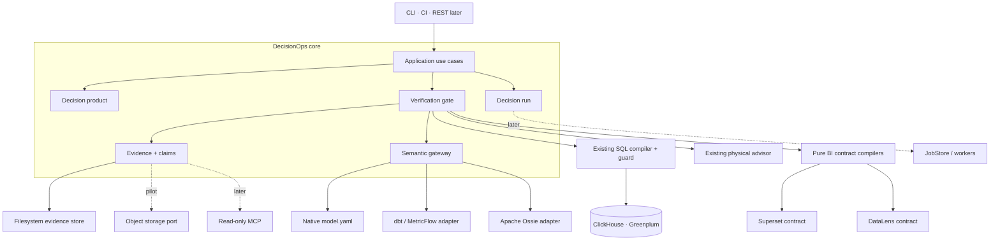
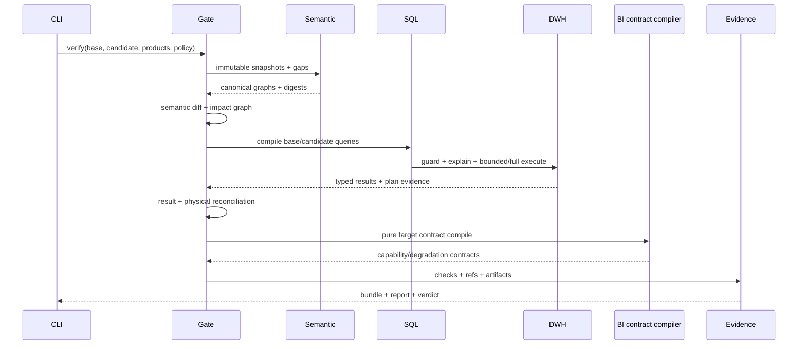

# Auto_BI DecisionOps — целевая архитектура

**Статус:** принято для архитектурного bootstrap; runtime-контракты ещё не реализованы
**Последнее обновление:** 2026-08-21
**Аудитория:** разработчики, analytics engineers, владельцы data platform
**Первый поставляемый продукт:** Analytics Release & Evidence Gate

Этот документ — нормативная архитектура нового проекта. Текущий дизайн
унаследованного dashboard compiler остаётся в [ARCHITECTURE.md](ARCHITECTURE.md),
а решение о форме нового проекта — в
[ADR 0003](adr/0003-decisionops-additive-control-plane.md). Стратегический
исследовательский вход сохранён без изменений в
[`decisionops-strategy-2026-08-21.md`](../decisionops-strategy-2026-08-21.md).

## Содержание

- [Контекст и baseline](#1-контекст-и-измеренный-baseline)
- [Архитектурный результат](#2-архитектурный-результат)
- [Обязательные инварианты](#3-обязательные-инварианты)
- [Границы системы](#4-границы-системы)
- [Архитектурный стиль](#5-архитектурный-стиль-и-зависимости)
- [Карта модулей](#6-целевая-карта-модулей)
- [Доменные контракты](#7-доменные-контракты)
- [Release & Evidence Gate](#8-analytics-release--evidence-gate)
- [Evidence architecture](#9-evidence-architecture)
- [Security и governance](#10-security-и-governance)
- [Persistence](#11-persistence-и-execution-evolution)
- [Interfaces](#12-interfaces-и-совместимость)
- [Observability](#13-observability)
- [Привязка к текущему коду](#14-использование-текущего-кода)
- [Verification strategy](#15-verification-strategy)
- [Последовательность поставки](#16-последовательность-поставки)
- [Риски](#17-риски-и-решения)
- [Открытые решения](#18-открытые-продуктовые-решения)
- [Bootstrap acceptance](#19-bootstrap-acceptance)
- [Источники](#20-источники)

## 1. Контекст и измеренный baseline

Новый проект создан из tracked-состояния `D:\Auto_BI` на commit
`b4bfa1d47db013b4529c8355da57c5e637a102d9`. Исходный checkout имел два
untracked presentation artifact; они, `.env`, виртуальные окружения, кеши и
логи не переносились. Копия стратегии имеет SHA-256
`69823b008dd98e0df5dd7fb4d324b6608afc927b88dee430b4fb83568be11f4f`.

| Показатель | Текущий checkout | Следствие |
|---|---:|---|
| Tracked-файлы | 324 | Это зрелый fork, не greenfield rewrite |
| Python source | 82 файла / 20 824 физических строки | Новый слой должен быть additive |
| Python tests | 100 файлов / 27 960 физических строк | v1 regression suite остаётся обязательной |
| Package | `autobi-agent` 0.5.0 | Имя пакета пока не меняется |
| Runtime | Python 3.12+, FastAPI, Pydantic, sqlglot, SQLite | Нового framework в MVP не требуется |
| Primary path | ClickHouse + Superset | Первый live gate углубляет этот путь |
| Secondary path | Greenplum + DataLens | Используется для cross-target contracts |

Физические строки отличаются от чисел в стратегическом документе более чем на
10%, вероятно из-за другой метрики LOC. Для планирования используются текущие
файлы и реальные архитектурные швы, а не старые оценки размера.

## 2. Архитектурный результат

Auto_BI DecisionOps — modular monolith, который выпускает аналитический продукт
как проверяемый артефакт. Первый вертикальный путь принимает base/candidate
семантику, набор защищаемых вопросов и dashboard specs, выполняет детерминированные
проверки и возвращает verdict вместе с воспроизводимым evidence bundle.

```text
semantic/model change
        +
protected decision products / verified questions
        |
        v
Analytics Release & Evidence Gate
        |
        +--> semantic + impact diff
        +--> SQL/security/physical checks
        +--> result reconciliation
        +--> BI compile contracts
        |
        v
verdict + evidence bundle + owner impact report
```

Продукт не начинает с scheduler, PostgreSQL, MCP, нового UI, новых BI-адаптеров
или write-actions. Эти возможности не нужны, чтобы доказать первый customer
outcome: безопаснее и быстрее выпускать изменения семантики и BI.

## 3. Обязательные инварианты

1. `DashboardSpec` остаётся presentation/query IR и не получает поля lifecycle,
   approvals или evidence.
2. Существующий `BIAdapter` остаётся контрактом remote mutation; release gate не
   вызывает `BIAdapter.build()`.
3. Формулы, joins, policy decisions, trust level и gate verdict вычисляет код,
   а не LLM.
4. Каждый run до исполнения фиксирует точные версии product spec, semantic
   snapshots, policy и среды.
5. Factual claim без валидного `evidence_ref` не попадает в governed или
   certified output.
6. Неизвестная или непереносимая семантика становится явным gap; adapters не
   восстанавливают её догадкой.
7. Любой SQL проходит существующие SELECT-only, dialect, RBAC, `EXPLAIN` и
   bounded/full-result controls.
8. `operational_status` и `gate_verdict` — разные поля: технически успешный run
   может завершиться verdict `block`.
9. Evidence content-addressed и канонизирован; одинаковый вход обязан давать
   одинаковые contract hashes.
10. Raw sensitive payload, prompt/message content и result rows не входят в
    telemetry или public evidence по умолчанию.
11. Interoperability реализуется version-pinned adapters; внешний semantic
    standard не становится внутренним public IR.
12. Observation, contribution, association, hypothesis и causal claim — разные
    типы. Causal claim запрещён до отдельного проверенного модуля.

## 4. Границы системы



### 4.1 Trust boundaries

| Граница | Вход считается недоверенным | Обязательный контроль |
|---|---|---|
| CLI/API → application | YAML/JSON, paths, actor context | strict schema, path confinement, authz |
| Semantic source → gateway | внешние manifests/specs | version pin, loss report, fail-closed validation |
| Core → DWH | скомпилированный SQL | SELECT-only guard, DWH role, policy context, budgets |
| Core → BI | target payload | pure contract compile; remote build только вне release gate |
| Core → evidence store | результаты и metadata | classification, redaction, content digest, retention |
| LLM → core | plan/text candidates | typed catalog, preconditions, evidence refs, no authority |

## 5. Архитектурный стиль и зависимости

На первые 90 дней система остаётся одним Python package и одним CLI process.
Границы задаются протоколами и направлением импортов, а не сетевыми сервисами.

```text
interfaces (CLI / REST later)
            |
            v
application use cases
            |
            v
decision · verification · investigation
      |          |             |
      +----------+-------------+
                 v
       semantic · evidence
                 |
                 v
ports: SemanticSource · QueryExecutor · ArtifactStore · Clock · Signer
                 |
                 v
existing Auto_BI + filesystem/SQLite adapters
```

Правила зависимостей:

- domain-модели не импортируют FastAPI, CLI, SQLite, HTTP clients или конкретную BI;
- `verification` оркестрирует ports, но не знает provider payloads;
- `semantic` не импортирует `decision`; обратная ссылка задаётся стабильными refs;
- `evidence` знает типизированные результаты проверок, но не выполняет запросы;
- существующие `agent`, `advisor`, `ir` и `adapters` используются через тонкие
  application adapters;
- новые директории создаются только вместе с первым исполняемым контрактом, а
  не как набор пустых placeholders.

## 6. Целевая карта модулей

```text
auto_bi/
  strict.py              StrictModel(extra="forbid") — унаследованный shared kernel
  refs.py                stable ids и version-pinned refs
  scalars.py             decimal / duration / UTC timestamp / sha256 скаляры
  decision/
    spec.py              DecisionProductSpec и lifecycle enums
    validate.py          cross-contract validation
    impact.py            product/owner impact и эскалация review→block
    use_cases.py         validate / verify application services
  semantic/
    metric_contract.py   governed metric definition
    gateway.py           source protocols, snapshot, gaps
    diff.py              semantic and impact diff
    metricflow.py        bounded dbt/MetricFlow import
    ossie.py             pinned Apache Ossie compatibility adapter
  verification/
    model.py             CheckResult, verdict and policy
    repository.py        VQR contracts
    reconcile.py         canonical result comparator
    release_gate.py      orchestration only
    bi_contract.py       pure target compile contracts
  evidence/
    model.py             bundle/claim/artifact schemas
    canonical.py         JCS bytes and digests
    manifest.py          bundle assembly and referential integrity
    store.py             ArtifactStore protocol + filesystem adapter
    lineage.py           internal edges + OpenLineage projection
  investigation/         starts only after release gate is proven
  jobs/                  starts only after recurring use is proven
  actions/               proposal-only, post-MVP
  mcp/                   read-only, post-REST contract
```

Это целевая карта, не требование создать все файлы сразу. Первый implementation
slice создаёт только contract-модели, которые нужны `decision validate`.

`refs.py` и `scalars.py` лежат рядом с существующим `strict.py` как shared kernel:
это грамматика идентичности и скаляров из §7.1, у них нет доменного состояния и они
не создают направления зависимости между `decision`, `semantic` и `evidence`. По той
же причине `evidence/canonical.py` не тянет ничего, кроме stdlib: contract-модели
импортируют его ради digest, а не ради evidence-домена.

## 7. Доменные контракты

### 7.1 Общие правила идентичности и версий

- Stable ids — lowercase URI-like строки, например
  `metric://sales/gross_margin_pct` и `decision://sales/weekly_margin`.
- `version` — монотонная доменная версия; Git SHA или provider version хранится
  отдельно как source revision.
- Любой immutable snapshot имеет `sha256:<hex>` digest канонических bytes.
- В canonical contract запрещены `NaN`, infinities и platform-dependent values.
- Денежные, ratio и tolerance values сериализуются decimal-строками, а не
  бинарными float.
- Время хранится в UTC RFC 3339; business timezone/calendar остаются явными
  полями metric contract.
- Unknown keys отклоняются существующей моделью `StrictModel(extra="forbid")`.

### 7.2 DecisionProductSpec

`DecisionProductSpec` — внешний контракт над одним или несколькими
`DashboardSpec`. Эскиз `v2alpha1`:

```yaml
api_version: auto-bi.io/v2alpha1
kind: DecisionProduct
metadata:
  id: decision://sales/weekly_margin
  version: 1
  owner: commercial-analytics
  risk_tier: medium
decision:
  question: Почему изменилась валовая маржа?
  consumer: commercial-director
  cadence: weekly
scope:
  metrics: [metric://sales/gross_margin_pct@3]
  dimensions: [region, category]
  time_window: P13W
verification:
  policy: policy://release/default@1
  freshness_max_age: PT6H
  cross_surface_tolerance: "0.000001"
delivery:
  dashboards:
    - ref: dashboard://weekly_margin@7
  brief_formats: [markdown]
actions:
  mode: disabled
```

В alpha-схеме `decision`, `owner`, `metric refs` и verification policy
обязательны. Cadence описывает продукт, но scheduler не входит в MVP.

### 7.3 MetricContract

Минимальная переносимая часть:

- id, version, owner, lifecycle status;
- formula ref или typed numerator/denominator;
- grain, allowed dimensions и join paths;
- additivity и non-additive axes;
- event time, timezone и calendar;
- unit, precision, null/zero semantics;
- freshness и data-quality preconditions;
- classification/policy refs;
- physical budgets;
- lineage refs и verified asset refs.

Порядок разрешения формулы: external governed reference → typed Auto_BI
expression → reviewed parameterized SQL. Raw SQL не становится дефолтом.

### 7.4 SemanticSnapshot и SemanticGap

`SemanticSource.snapshot(ref) -> SemanticSnapshot` возвращает:

- source kind/version/revision;
- canonical graph поддержанного subset;
- source digest и canonical digest;
- declared capabilities;
- список `SemanticGap(path, reason, severity, source_value_ref)`;
- physical/catalog/policy refs без секретов.

Native `model.yaml` — первый source adapter. Текущий `dbt_import.py` остаётся
enrichment helper и не объявляется полноценным MetricFlow importer. Apache
Ossie (бывший OSI) используется через adapter, pinned на tag или commit;
неизвестные `custom_extensions` сохраняются для round-trip, но не получают
выдуманную внутреннюю семантику.

### 7.5 Verified Asset Repository

Verified asset содержит:

- canonical question и paraphrases;
- intent и metric refs;
- ожидаемое уточнение/refusal для negative cases;
- reference query plan;
- expected canonical result или invariants;
- tolerance, действующие semantic versions и risk tier;
- reviewer, rationale и review timestamp.

Production interaction попадает только в redacted review queue. Benchmark или
expected result никогда автоматически не добавляется в LLM context.

### 7.6 DecisionRun, статусы и verdict

Operational lifecycle:

```text
created -> running -> completed
                  \-> failed
                  \-> cancelled   # post-MVP cooperative cancellation
```

Gate verdict вычисляется независимо:

```text
pass | pass_with_advisory | needs_review | block
```

`completed + block` — нормальный результат проверки, не системная ошибка.
`failed` означает, что gate не смог вынести полный verdict из-за runtime fault.

Идемпотency key для one-shot verify строится из digest product spec, base и
candidate snapshots, policy version, execution environment и verifier version.
Повтор может переиспользовать только полный terminal bundle с тем же ключом.

### 7.7 CheckResult, Claim и EvidenceBundle

Каждая проверка возвращает typed `CheckResult`:

```text
check_id · check_version · category · subject_refs
status(pass/advisory/review/block/error)
summary_code · evidence_refs · started_at · duration_ms
```

Человекочитаемый текст не является кодом результата. `summary_code` стабилен и
подходит для CI, локализация формируется отдельно.

`Claim` содержит `claim_type`, structured value, unit, comparison semantics,
support/caveats и непустой список evidence refs. Bundle assembler проверяет
существование refs и запрещает certified output при dangling reference.

## 8. Analytics Release & Evidence Gate

### 8.1 Вход и выход

Вход:

- base/candidate semantic refs;
- decision product refs или dashboard specs;
- VQR selection;
- DWH/BI environment refs;
- verification policy и actor context.

Выход:

- operational status + gate verdict;
- список affected metrics/questions/charts/products/owners;
- structured check results;
- JSON evidence bundle;
- derived Markdown summary;
- стабильный process exit code.

### 8.2 Последовательность



Gate выполняет шаги в фиксированном порядке:

1. validate входных contracts;
2. load и freeze semantic snapshots;
3. reject blocking semantic gaps;
4. построить semantic diff и impact graph;
5. инвалидировать затронутые verified assets;
6. compile base/candidate SQL;
7. выполнить security, access, freshness и physical checks;
8. reconcile полные typed results;
9. compile Superset/DataLens contracts без remote mutation;
10. собрать и повторно провалидировать evidence bundle.

Реализовано в `verification/release_gate.py`. Что важно в реализации:

- Шаг 6 реализован в `verification/sql_contract.py` — reference query метрики: её
  определение на её же grain, без окна, фильтра и top-N (это принадлежит продукту и
  прогону, не метрике). Граница узкая намеренно: typed aggregate компилируется
  (`SUM(col)` по сгруппированной витрине значит одно и то же в обоих движках).
  Governed ratio компилируется **на двух семействах движков, чьё десятичное деление
  проверено на живом движке**, и на каждом — своей формой; вывести одну из другой нельзя,
  поэтому незнакомый семье движок получает названный гэп (`sql.ratio_unverified`), а не
  SQL, за который гейт не может ручаться. Движок читается по имени (`is_known_engine`), а
  не по диалекту: `sqlglot_dialect` подставляет v1-движок незнакомому имени — допущение,
  честное для `SUM(col)` и никакое для формы из engine-specific синтаксиса.
  **ClickHouse** (проверено на 24.8.14.39) — `divideDecimal(num, den, precision)`:
  десятичное деление зависит от движка (ClickHouse сохраняет масштаб делимого на
  `Decimal / Decimal`, и chart-путь отвечает на это приведением к Float64 —
  display-решение, которое governed-метрика с объявленной precision наследовать не
  должна), а `divideDecimal` делит точно и усекает к нулю на объявленной precision, каким
  бы ни был масштаб слагаемых; он читает значения знаменателя ПОД NULL-маской, поэтому
  `NULLIF(den, 0)` сам по себе всё равно даёт `ILLEGAL_DIVISION` — ноль подменяется внутри
  вызова, а строка занулевается охраной снаружи; аргументы обязаны быть Decimal, поэтому
  счётные и целочисленные термы приводятся. **PostgreSQL-семейство** (проверено на
  PostgreSQL 14.24 — реализации `numeric`, которую наследуют Greenplum и Greengage; живого
  Greengage-стенда не было) — `TRUNC(num * 1.000000 / NULLIF(den, 0), precision)`:
  `numeric`-деление точно, но его масштаб выбирается по операндам под ~16 значащих цифр,
  поэтому на большом частном `TRUNC(a / b, p)` дописал бы нули, которых деление не считало;
  умножение делимого на точную единицу с объявленным числом знаков поднимает масштаб, не
  трогая значение (приведение к `numeric(_, p)` округлило бы), а при precision 0 множитель
  всё равно десятичный, иначе `/` над целочисленными термами усечёт раньше `TRUNC`. Здесь
  `/` уважает NULL-маску, поэтому охраны вокруг деления не нужно, а `TRUNC` усекает к нулю
  — как `divideDecimal`, так что одно governed-число читается одинаково на обоих движках. Терм, чей
  агрегат не даёт точного десятичного числа (AVG, Float-колонка), — `sql.ratio_inexact_term`;
  колонка, которой нет в модели, — `sql.term_undeclared`.
  External/reviewed-SQL формула — чужое определение и не пере-выводится.
  Все находки шага advisory: почему метрика поехала, уже оценили diff и impact, и
  вторая оценка дала бы одному изменению два веса в вердикте. Агрегат берётся из
  `agent/sqlgen.aggregate_expr` — той же функции, что и chart-путь.
- Шаг 7 реализован наполовину и разделён надвое: чистый слой
  `verification/environment.py` (какие вопросы задать движку, как выглядит ответ и что он
  значит) и IO `verification/environment_probe.py` поверх того же read-only `RunQuery`, что
  и интроспекция с advisor. Гейт оценивает факты, а не держит соединение, и те же факты
  ложатся в bundle. `dwh.access`: роль умеет только читать (иначе **block** — инвариант 3) и
  каждая витрина скоупа есть и читается (иначе block). `dwh.freshness`: возраст самой свежей
  строки против `freshness_max_age` продукта, измеренный от `created_at` прогона, — протухший
  источник **review**. **Проверка записи никогда не делается записью**: на ClickHouse решает
  профиль (`readonly=1` отказывает даже при `GRANT INSERT ON *.*` из `users.xml`), на
  PostgreSQL — `has_table_privilege` плюс проверка на суперпользователя. Пустая витрина —
  `freshness.unknown`, потому что `max(Date)` по нулю строк в ClickHouse равен `1970-01-01`,
  а не NULL. Прогон без `--dwh` выносит обе проверки как `check.not_configured` — ответ, а не
  пропуск; physical и security половины шага остаются `check.not_implemented` (advisory), а
  не отсутствуют молча: чистый bundle не должен читаться как полная верификация.
- «Reject blocking semantic gaps» останавливает последовательность ТОЛЬКО на
  `gap.contract_invalid`: непрочитанный контракт отсутствует в графе, и diff назвал
  бы это удалённой метрикой. Остальные blocking-гэпы (dangling join, отсутствующее
  поле метрики) описывают правдивый граф с названной дырой — diff и impact по нему
  по-прежнему стоит читать, а сам гэп уже блокирует релиз. Пропущенные шаги выходят
  как `check.not_run` (review), не как pass.
- Шаг 8 берёт кандидатные результаты из порта `ResultSource`. Отсутствие ответа —
  `insufficient` (review), никогда pass: сравнение, которого не было, не
  доказывает, что число не поехало. Продукт, у которого вообще нет verified asset
  с ожидаемым результатом, получает `result.no_expectations` (advisory).
- Проверка `evidence.bundle` есть в отчёте, но не в bundle: она оценивает
  повторную верификацию самого bundle, а проверка не может адресовать артефакт,
  который валидирует.
- `CheckResult` намеренно без `started_at`/`duration_ms`: стенные часы внутри
  content-addressed артефакта ломают воспроизводимость (§9.1), а наблюдаемость
  живёт в trace (§13), не в evidence.

### 8.3 Semantic diff

| Изменение | Default classification |
|---|---|
| Description/label only | advisory |
| Добавлена необязательная dimension | pass/advisory |
| Formula, numerator/denominator, grain или additivity | review/block по impact |
| Timezone/calendar/null policy | block для affected verified assets |
| Удалён field/metric/join path | block |
| Policy/classification ослаблена | block + security finding |
| Physical key/partition изменены | re-run physical gate |
| External field не отобразился в canonical graph | explicit gap, не silent pass |

Impact graph строится по stable refs:

```text
source field -> metric -> verified asset -> chart -> decision product -> owner
```

### 8.4 Result reconciliation

- Schema сравнивается до values: names, logical types, nullability и units.
- Rows канонизируются по объявленному business key; если key не уникален,
  проверка завершается `needs_review` или `block`, а не случайной сортировкой.
- Integer/decimal сравниваются точно; float допускается только с metric-specific
  absolute/relative tolerance.
- `NULL`, missing row, zero и empty set — разные состояния.
- Order учитывается только когда он является частью контракта (rank/top-N).
- Bounded/truncated result не может доказывать полную числовую эквивалентность.
- Aggregates получают metamorphic checks: partition conservation, share sum,
  ratio reconstruction и additive decomposition.

### 8.5 Чистый BI compile seam

Существующий `BIAdapter` смешивает compile и remote mutation. Для release gate
добавляется отдельный port:

```python
class BIContractCompiler(Protocol):
    target: TargetBI

    def capabilities(self) -> TargetCapabilities: ...

    def compile_contract(
        self,
        spec: DashboardSpec,
        model: SemanticModel,
    ) -> CompiledBIContract: ...
```

Реализации переиспользуют pure builders из Superset `form_data`/native filters
и DataLens chart/dataset config. Production `BIAdapter.build()` и новый compiler
должны вызывать одни и те же pure functions; дублирование payload logic запрещено.
Release gate не создаёт datasets/charts/dashboards и не запускает cleanup.

`TargetCapabilities` **возвращает** compiler, а не принимает (первоначальный
sketch принимал их аргументом): карта viz читается из тех же пиннутых таблиц
адаптера (`VIZ_TYPE`, `VIZ_ID`, `DEGRADED`), а вызывающий, способный передать
capabilities, мог бы объявить поддержку, которой у компилятора нет. Единственный
параметр окружения — `target_version` (версия стенда), он же входит в digest.

Компилируемый контракт намеренно НЕ содержит три вещи, и каждая названа явно, а не
обнаруживается постфактум:

| Не входит | Почему |
|---|---|
| Remote ids datasets/charts | их выдаёт BI на create; контракт использует детерминированные `native_id`-плейсхолдеры, иначе один и тот же вход давал бы разные digest |
| DWH connection payload | несёт пароль: environment binding, не compile artifact (§10.2) |
| Live-measured display scale | `_ru_scale` меряет величину на живом стенде; offline-значения нет — объявляется как `live_measured_display_scale=False` (инвариант 6) |

Payload'ы исключены из dump контракта: контракт несёт content addresses, а байты
уезжают в evidence store блобами (§9.1). Digest артефакта проверяется против
payload, когда payload присутствует, поэтому контракт в памяти не может соврать о
том, что скомпилировал, а прочитанный из evidence — по-прежнему проверяет своё тело.

## 9. Evidence architecture

### 9.1 Канонизация и digest

Manifest канонизируется по JSON Canonicalization Scheme (RFC 8785), затем
хешируется SHA-256. До выбора библиотеки реализация обязана пройти official
test vectors; обычный `json.dumps(sort_keys=True)` не объявляется JCS.

Чтобы избежать неоднозначной number serialization:

- contract decimals хранятся строками;
- non-finite numbers запрещены;
- negative zero отклоняется на границе;
- Unicode не нормализуется неявно;
- bytes хранятся отдельным blob и адресуются digest.

### 9.2 Layout bundle

```text
evidence/<run_id>/
  manifest.json              canonical root metadata
  checks/<check_id>.json     typed check results
  reports/summary.md         derived, never source of truth
  blobs/sha256/<digest>      content-addressed payloads
  restricted/               optional encrypted/raw payload store
```

Public manifest содержит digest и classification restricted payload, но не его
raw contents. Artifact paths строит store, а не пользователь; `..`, absolute
paths и symlink escape запрещены.

`reports/summary.md` пишет `verification/summary.py` — единственный артефакт в
layout, написанный для человека, а не для машины. «Derived» здесь контракт, а не
оговорка: отчёт пересказывает findings уже оценённых check'ов в порядке, нужном
владельцу (что блокирует релиз → чьи числа задеты → что решает человек → что
прогон НЕ сделал), и не вводит ни одного собственного. Два следствия из того, где
он лежит: он не оценивает `evidence.bundle` (эта проверка судит артефакт, внутрь
которого отчёт запечатан, и решается уже после запечатывания), и в нём нет ни
часов, ни зависящего от словаря порядка — одинаковый вход обязан давать те же
байты, потому что байты входят в content address (§9.1). Строка
`result.no_expectations` намеренно попадает в раздел «что не сделано», а не
теряется среди advisory: гейт, который не сравнил ни одного числа, ничего про
числа не проверил.

### 9.3 Integrity и подпись

Local/MVP guarantee — `integrity=content_hashed`, не «подписано» и не
«tamper-proof». `EvidenceSigner` вводится как optional port. Только успешная
верификация подписи позволяет выставить `integrity=signed`; provider ключа/KMS
не выбирается до pilot requirements.

### 9.4 Lineage

Внутренний graph хранит типизированные edges, достаточные для impact analysis.
Экспорт использует OpenLineage dataset/run model и column-level lineage facets.
Custom facets получают versioned immutable schema URL и префикс `autoBi`, а не
подменяют стандартные поля.

## 10. Security и governance

### 10.1 Actor и policy context

Каждый run фиксирует actor id, tenant, roles, policy version и DWH role. Prompt
policy не является security boundary. Row/column/tenant restrictions должны
исполняться DWH role или deterministic query rewrite и проверяться negative
tests.

Cache/reuse key включает actor/tenant/policy context. Cross-tenant result cache
запрещён даже при одинаковом SQL digest.

### 10.2 Data minimization

- Каждый check/skill объявляет необходимый уровень данных.
- По умолчанию сохраняются schema, counts, digests и aggregates.
- Raw rows, SQL text и prompt/message bodies управляются отдельной retention и
  classification policy.
- Existing `SEND_SAMPLES=false` и запрет confidential/restricted samples
  сохраняются.
- GenAI input/output telemetry остаётся opt-in: upstream OpenTelemetry прямо
  предупреждает о PII/sensitive content.

### 10.3 Human authority

- metric и decision product имеют owner;
- verified asset имеет reviewer;
- `needs_review` не преобразуется автоматически в pass;
- action mode в MVP — `disabled`;
- proposal-only connectors появляются после отдельного approval/idempotency ADR.

### 10.4 Основные угрозы

| Угроза | Контроль |
|---|---|
| Hallucinated formula/join | governed refs + strict semantic validation |
| Evidence-less narrative | referential-integrity gate |
| Permission leak | actor-bound DWH execution + adversarial fixtures |
| Stale source | snapshot timestamp/version + freshness gate |
| Partial result accepted as full | explicit completeness marker |
| Evidence tampering | canonical digest; optional verified signature later |
| Path traversal/artifact overwrite | store-owned paths + confinement |
| BI side effects during CI gate | pure compiler port; no `build()` |
| External schema drift | version pin + conformance fixtures + gap report |
| Duplicate later action | typed idempotency key + postcondition ledger |

## 11. Persistence и execution evolution

### 11.1 MVP

- Decision products и metric contracts — Git-tracked YAML/JSON.
- VQR — Git-tracked fixtures с review metadata.
- Verify — synchronous one-shot CLI.
- Evidence — filesystem `ArtifactStore` с atomic temp-write + rename.
- Existing SQLite schema v9 не меняется в первом contract slice.
- Один process/worker; remote mutation отсутствует.

### 11.2 Pilot

До добавления PostgreSQL вводятся ports `ProductRepository`, `RunRepository`,
`JobStore`, `ArtifactStore` и `Outbox`. Pilot backend может использовать:

- PostgreSQL для registry, runs, leases, approvals и outbox;
- filesystem/S3-compatible object store для больших artifacts;
- `SELECT ... FOR UPDATE SKIP LOCKED` только после lease/CAS tests;
- отдельные API и worker processes.

Redis/Kafka не добавляются без измеренного contention/throughput requirement.

## 12. Interfaces и совместимость

### 12.1 CLI

Первый surface:

```text
auto_bi decision validate <product.yaml>
auto_bi decision verify <product.yaml> --base <ref> --candidate <ref> --evidence <dir>
auto_bi decision evidence <run-or-path>
```

Exit codes стабильны и различают verdict и runtime error. Значения зафиксированы
contract-тестом `tests/test_decision_cli.py::test_exit_code_contract_is_stable`
и реализованы в `auto_bi/verification/model.py`:

| Код | Значение |
|---|---|
| 0 | `pass` / `pass_with_advisory` — ничто не блокирует релиз |
| 2 | runtime или usage error (то же, что у argparse и v1 CLI) |
| 3 | `needs_review` — нужен человек, автоматического вердикта нет |
| 4 | `block` — изменение не должно уехать в текущем виде |

`1` намеренно не используется: это код необработанного исключения, и падение не
должно выглядеть как вынесенный verdict (инвариант 8). Прогон, который не нашёл
ни одного decision product, завершается `2`, а не «pass».

Реализовано:

```text
auto_bi decision validate <paths…> [--json]
auto_bi decision verify <paths…> --base <ref> --candidate <ref> --evidence <dir>
        [--dashboards <dir>] [--assets <path>] [--results <file>]
        [--product <id>] [--environment <ref>] [--created-at <ts>] [--json]
auto_bi decision evidence <run-or-path> [--run <id>] [--artifact <id>]
        [--expect-digest <sha256:…>] [--json]
```

`validate` — offline cross-contract проверка (продукты ↔ metric contracts).
`verify` — полный гейт §8.2 для ОДНОГО продукта: один run = один продукт, потому
что и idempotency key, и evidence bundle называют один `product_ref`.
`evidence` — чтение уже написанного bundle: пересчёт каждого content address,
список claim'ов и артефактов, при `--artifact` — сам payload. Его вердикт про
целостность, а не про релиз: целый bundle с вердиктом `block` внутри — это
рабочий bundle, и команда выходит с `0`. `restricted`-payload не печатается
никогда (§10.2), а артефакт, который больше не хешируется в свой адрес, не
выдаётся вовсе — это уже не то, на чём принималось решение.

Формат входов (`decision/use_cases.py` — единственный слой, который читает ФС):

| Вход | Форма |
|---|---|
| semantic ref (`--base`/`--candidate`) | каталог с `model.yaml` и необязательным `metrics/` |
| dashboard spec | `<segment>@<version>.yaml` — имя файла несёт пин, иначе продукт с `@7` молча подхватил бы вёрстку `@8` |
| verified assets | файл или каталог YAML (`VerifiedAsset`) |
| recorded results | `{asset id: ResultSet}` — кандидатные ответы, снятые вне гейта |

`--created-at` задаётся явно, когда прогон должен быть байт-в-байт
воспроизводимым: часы внутри content-addressed артефакта делают одинаковый вход
разным bundle каждый раз.

### 12.2 REST

`/api/v1` не меняется. `/api/v2` появляется после стабилизации Pydantic-моделей
и вызывает те же application use cases, что CLI. HTTP schema не становится
местом бизнес-логики.

### 12.3 MCP

MCP отложен до стабильного REST/policy/evidence contract. Актуальная версия
2026-07-28 стала stateless; долгие операции используют отдельное Tasks
extension. Поэтому будущий MCP adapter возвращает явный run/task handle и
привязывает его к authorization context, но эти transport детали не входят в
domain state machine.

## 13. Observability

Существующие `trace_events` и `llm_calls` сохраняются для v1. DecisionOps event
имеет `run_id`, `product_id`, `check_id`, `semantic_digest`, `policy_digest`,
`status`, `duration` и correlation id.

- Span names и основные attributes — low-cardinality.
- SQL/result/prompt bodies не записываются в spans по умолчанию.
- Audit trail отделён от operational trace и имеет собственную retention.
- Evidence bundle содержит ссылки на traces, но его корректность не зависит от
  доступности telemetry backend.
- Telemetry failure не меняет gate verdict, но фиксируется advisory check, если
  policy требует наблюдаемость.

## 14. Использование текущего кода

| Текущий модуль | Роль в новом проекте | Ограничение |
|---|---|---|
| `ir/spec.py` | presentation/query IR | не расширять lifecycle полями |
| `ir/validate.py` | semantic validation | вызывается до любого SQL/BI seam |
| `semantic/model.py` | native source schema | не выдавать за полный MetricContract |
| `semantic/dbt_import.py` | enrichment baseline | не выдавать за MetricFlow gateway |
| `agent/sqlgen.py` | deterministic query compiler | SQL digest после final render |
| `agent/sql_guard.py` | execution security gate | exact SQL, actor-bound role |
| `agent/query_plan.py` | run-local plan/trial evidence | не reuse между snapshots/runs |
| `advisor/*` | physical/cost checks | finding превращается в CheckResult |
| `adapters/*` | delivery + source pure builders | remote build запрещён release gate |
| `agent/insights.py` | будущие skill primitives | thresholds требуют calibration |
| `store/db.py` | v1/local operational patterns | не наращивать до нового god store |
| `eval/*` | VQR/scenario harness seed | expected results отделены от prompts |
| `api/*` | v1 compatibility | v2 добавляется рядом |

## 15. Verification strategy

### 15.1 Contract layer

- strict unknown-field rejection;
- round-trip без потерь;
- deterministic JCS digest на official vectors;
- stable ids и version invalidation;
- claim/evidence referential integrity;
- path confinement и redaction.

### 15.2 Semantic и result layer

- seeded formula, grain, time, additivity, policy и removal diffs;
- loss-aware native/dbt/Ossie fixtures;
- row-order-independent reconciliation;
- exact decimal и bounded float tolerance;
- null/zero/missing distinctions;
- metamorphic aggregate properties.

### 15.3 Release scenarios

| Сценарий | Покрыт |
|---|---|
| breaking metric change блокируется с exact impact | ✅ `tests/test_decision_verify.py` — 4 seed'а (formula, grain, event time, removed field) до владельца и дашборда |
| presentation-only change не блокируется | ✅ там же |
| Superset/DataLens compile contracts используют общий canonical query | ✅ `tests/test_bi_contract.py` — сравнение **объектов** builder'ов, не результатов |
| отсутствие evidence ref ломает bundle validation | ✅ `tests/test_evidence_bundle.py` |
| gate не вызывает remote mutation methods | ✅ socket-запрет + mutation-spy на каждом глаголе обоих BI-клиентов |
| expensive candidate plan блокируется policy | ⛔ ждёт §8.2 шаг 7 (physical/cost checks поверх `advisor/*`) |
| stale source возвращает honest insufficient/block | ✅ stale **verified asset** → `asset.stale_snapshot` (review), недоступный результат → `insufficient`, freshness самого источника → `dwh.freshness` (review) при `--dwh` (`tests/test_environment_checks.py`) |

### 15.4 Compatibility gate

После каждого behavioral slice запускаются focused tests нового namespace и
релевантные v1 regression tests. Полный существующий suite остаётся release
gate; live DWH/BI/LLM проверки не повторяются без изменённого seam или явной
acceptance необходимости.

## 16. Последовательность поставки

```text
Architecture bootstrap
  -> contract kernel + validate CLI
  -> native semantic snapshot + diff
  -> VQR + result comparator
  -> one-shot release/evidence gate
  -> pure Superset/DataLens compile conformance
  -> typed investigation + certified brief
  -> recurring runs / PostgreSQL
  -> read-only MCP / proposal actions
```

Hard gate после one-shot release gate: если нет реального pilot change,
измеримого сокращения review time и design partner evidence, scheduler/MCP/
actions не начинаются.

## 17. Риски и решения

| Риск | Архитектурный ответ |
|---|---|
| Scope explosion | один vertical wedge; later modules gated evidence |
| Fork расходится с v1 | upstream baseline зафиксирован; v1 tests не удаляются |
| Canonical graph становится новым стандартом | private bounded model + adapters |
| Apache Ossie меняется | pin commit/tag + conformance corpus + explicit gaps |
| BI compiler расходится с build | shared pure builders + mutation-spy tests |
| Result comparator даёт false equivalence | typed schema/key/unit/completeness before values |
| Evidence слишком тяжёлый/чувствительный | content-addressed blobs + restricted store |
| SQLite переписывается раньше продукта | file-based MVP + repository ports first |
| LLM создаёт ложную уверенность | deterministic verdict + typed claim classes |

## 18. Открытые продуктовые решения

Эти вопросы не блокируют contract kernel, но требуют owner evidence до
соответствующей фазы:

1. Первый pilot workflow и named owner.
2. Первый внешний semantic source: direct dbt/MetricFlow или Apache Ossie
   artifact после native source.
3. Нужен ли отдельный distribution/package name до `v0.6.0`.
4. Где будет новый remote repository.
5. Нужна ли подпись evidence и какой trust root допустим.
6. Нужен ли PostgreSQL в pilot или filesystem/SQLite достаточно.
7. Какой BI contract требует live result reconciliation первым.

## 19. Bootstrap acceptance

Архитектурный bootstrap завершён, когда:

- отдельный repo существует и не имеет случайного remote;
- исходный `Auto_BI` и его untracked artifacts не изменены;
- стратегический input сохранён с проверенным hash;
- этот документ и ADR задают границы, состояния, data flow, security,
  persistence и verification;
- runtime остаётся byte-equivalent tracked baseline, кроме documentation;
- import smoke и offline focused verification baseline зелёные.

## 20. Источники

Локальные:

- [DecisionOps strategy snapshot](../decisionops-strategy-2026-08-21.md)
- [Auto_BI baseline architecture](ARCHITECTURE.md)
- [Current baseline state](CURRENT_STATE.md)
- [BIAdapter ADR](adr/0001-bi-adapter-contract.md)
- [Durable build-attempt ADR](adr/0002-durable-build-attempt-reconciliation.md)

Первичные внешние:

- [Apache Ossie (formerly Open Semantic Interchange)](https://github.com/apache/ossie)
- [OpenLineage column-level lineage facet](https://openlineage.io/docs/spec/facets/dataset-facets/column_lineage_facet/)
- [RFC 8785 — JSON Canonicalization Scheme](https://www.ietf.org/rfc/rfc8785.pdf)
- [OpenTelemetry GenAI semantic attributes](https://opentelemetry.io/docs/specs/semconv/registry/attributes/gen-ai/)
- [MCP specification update 2026-07-28](https://blog.modelcontextprotocol.io/posts/2026-07-28/)
- [MCP Tasks extension](https://tasks.extensions.modelcontextprotocol.io/specification/draft/tasks)
